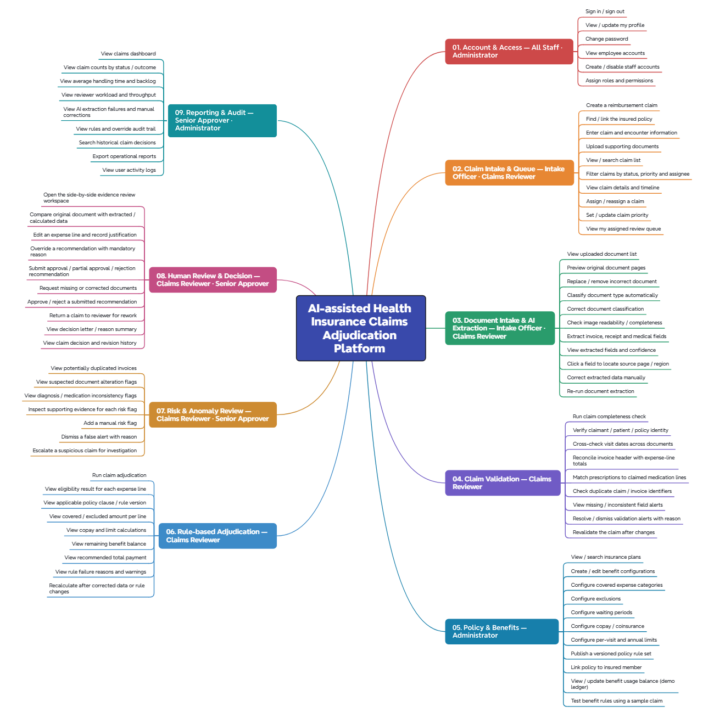
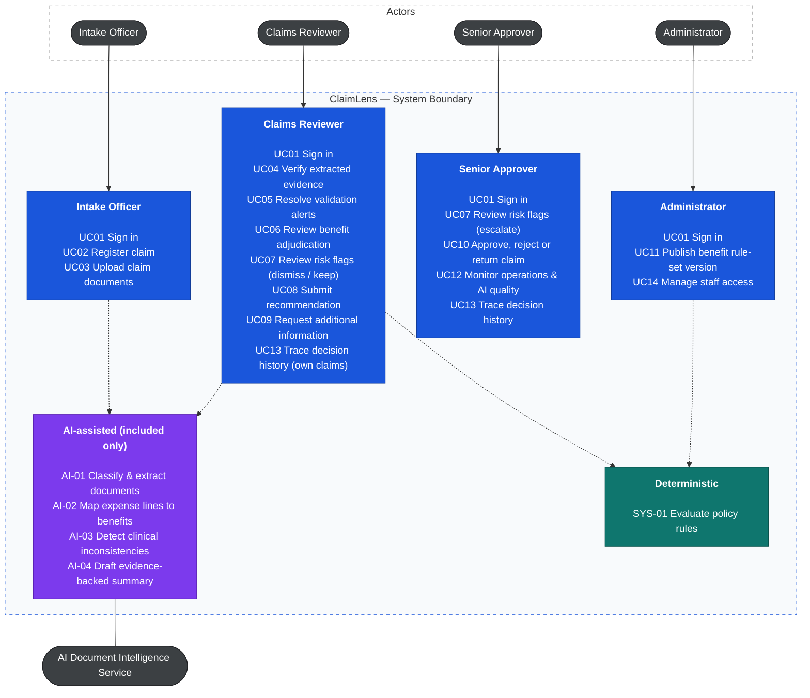
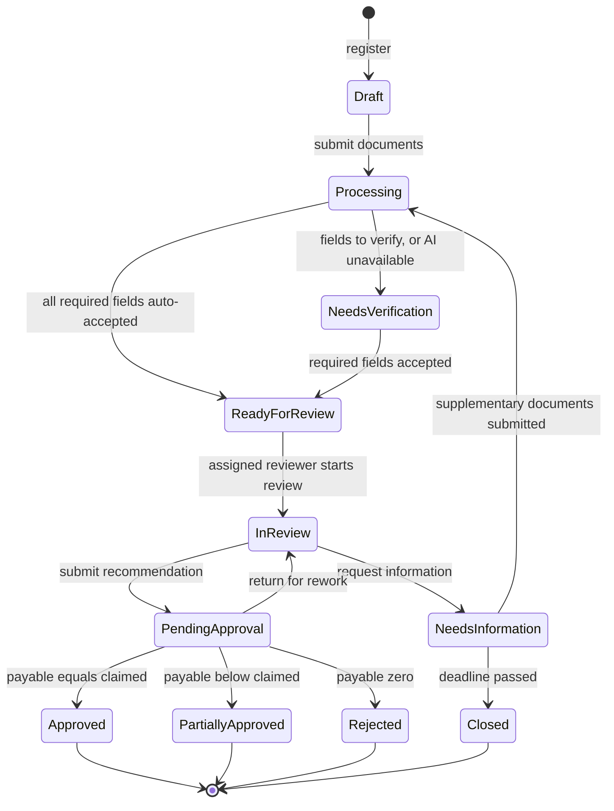
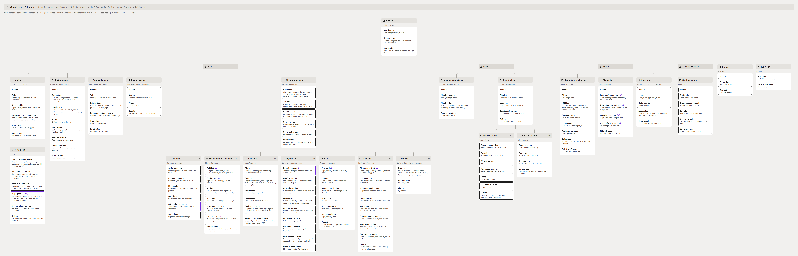
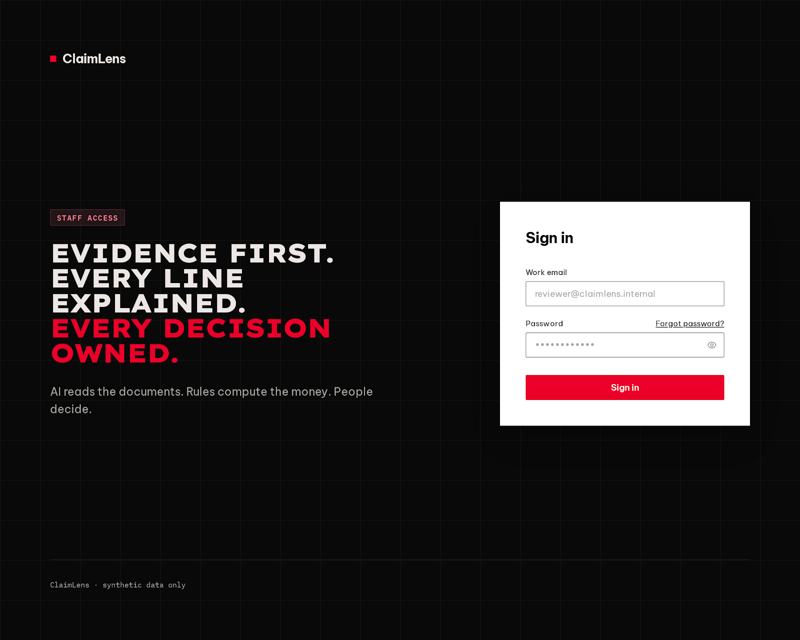
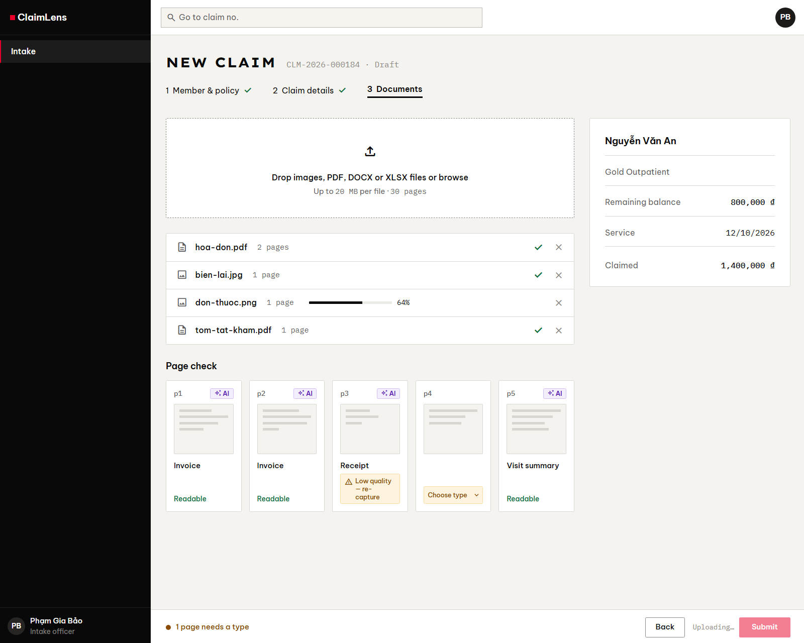
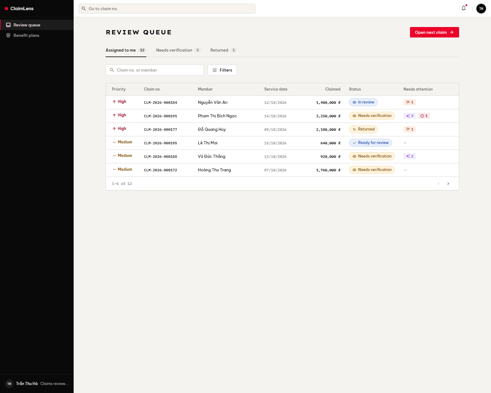
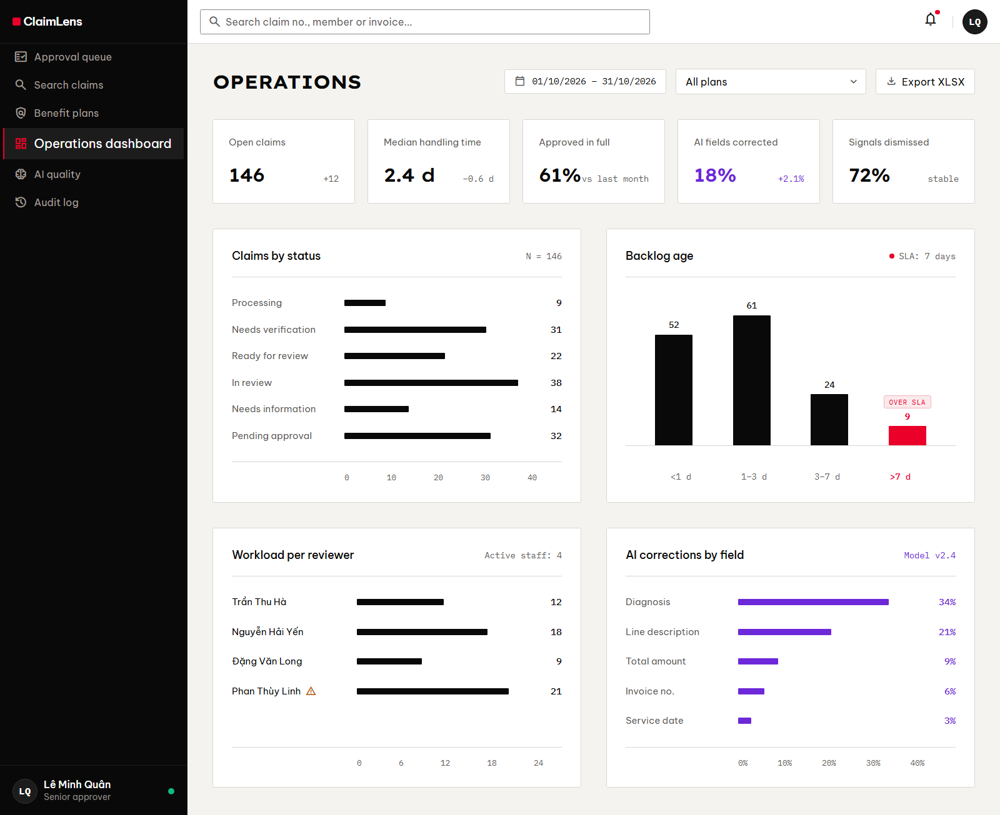

# ClaimLens

ClaimLens is an evidence-grounded, AI-assisted workbench for adjudicating outpatient health insurance claims. It turns a packet of photographed invoices, receipts and prescriptions into sourced facts, evaluates every expense line against the policy version in force on the service date, and gives a human reviewer and approver everything they need to make an explainable, two-person decision.

The product rests on one principle: **AI reads, the Rule Engine calculates, people decide.**

## 1. Requirements — INVEST, Use Cases, and Acceptance Criteria

Requirements define what ClaimLens must do, who uses it, where AI is allowed to help, and the observable conditions of success. User stories are reviewed with INVEST and traced to use cases, business rules and screens.

### 1.1 Feature map



### 1.2 Who decides what

| Layer | Owns | Never does |
|---|---|---|
| **AI** (Document Intelligence Service) | Perception and language: classify pages, read documents, map free-text services to benefit categories, notice clinical inconsistencies, draft explanations. | Decide coverage, compute money, approve or reject, label a person as fraudulent. |
| **Rule Engine** (deterministic) | Eligibility, waiting period, exclusions, reimbursement rate, limits and the payable amount, reproducible for a given rule-set version. | Read unstructured documents or guess missing values. |
| **Human** (Reviewer, Senior Approver) | Verifying evidence, resolving conflicts, overriding with a reason, the final decision. | Approve their own recommendation (maker–checker). |

Every AI output is a **suggestion with a confidence and a source location**. Values below their threshold are left for a person to verify or enter, never guessed.

| AI output | Auto-accepted suggestion | Needs a person | Left empty |
|---|---|---|---|
| Page type | ≥ 0.80 | < 0.80 → "Unclassified" | — |
| Field value (general) | ≥ 0.90 | 0.70–0.90 → "Needs verification" | < 0.70 → "Needs entry" |
| Field value (money & identity) | ≥ 0.95 | 0.70–0.95 → "Needs verification" | < 0.70 → "Needs entry" |
| Expense line → benefit category | ≥ 0.85 | < 0.85 → reviewer confirms | — |

Before submitting a recommendation, the reviewer attests to every auto-accepted value used in the calculation, so no AI value reaches a decision without a human seeing it.

**Worked example (golden case).** A claim of 1,400,000 VND has 1,100,000 VND of eligible expenses. At an 80% reimbursement rate that is 880,000 VND, capped by a remaining limit of 800,000 VND. The payable amount is **800,000 VND**, and every line shows its result, rule code and formula.

### 1.3 INVEST requirements

The MVP backlog includes 25 user stories across 9 epics. Before a story is ready for development, it is checked against INVEST.

| Criterion | Meaning in ClaimLens |
|---|---|
| **Independent** | Each story delivers one capability and depends on other stories only where the claim workflow requires it. |
| **Negotiable** | Layout and technical design can change as long as the AI / Rule Engine / Human boundary and the business rules hold. |
| **Valuable** | Each story saves reviewer time, prevents a wrong payment, or makes a decision explainable or auditable. |
| **Estimable** | Roles, inputs, thresholds, rule versions and failure outcomes are documented. |
| **Small** | Each story covers one primary capability and splits into API, rule, AI, persistence, UI and test tasks. |
| **Testable** | Every story has Given/When/Then acceptance criteria, including permission, threshold and AI-unavailable behaviour. |

```text
US01–US02, US25   E1 Access & routing
US03–US04         E2 Intake
US05–US07         E3 Document AI
US08–US10         E4 Validation
US11–US14         E5 Adjudication
US15              E6 Risk
US16–US20         E7 Decision
US21–US22         E8 Policy rules
US23–US24         E9 Oversight
```

The MVP release is all **Must** stories (19 stories, 88 points). **Should** stories (6 stories, 24 points) follow in the next increment; each has a manual equivalent, so the product works without them. Seven stories carry AI (US05, US06, US07, US10, US11, US15, US16). The complete backlog, acceptance criteria and per-story INVEST review are maintained in [INVEST Requirements](docs/08-invest-requirements.md).

### 1.4 Use cases



AI use cases are never started by a person: they are included by a business use case or extend one at a declared extension point, and always lead into a human verification step. AI is deliberately absent from benefit calculation, eligibility, rule authoring, approval, access control and request letters.

For the full UML diagram with `«include»` / `«extend»` relationships, actor specifications and the reasoning behind each AI placement, see [Actors, roles, and use cases](docs/03-use-cases.md). A strict PlantUML version is in [use-case.puml](docs/diagrams/use-case.puml).

### 1.5 Roles and permissions

| Capability | Intake | Reviewer | Approver | Administrator |
|---|---|---|---|---|
| Register claims and upload documents | Yes | No | No | No |
| Verify evidence, resolve alerts, review adjudication | No | Yes | No | No |
| Override a line result (reason required) | No | Yes | No | No |
| Submit recommendation, request information | No | Yes | No | No |
| Handle risk flags | No | Dismiss / keep | Escalate | No |
| Approve, partially approve, reject or return | No | No | Yes | No |
| Publish benefit rule sets | No | Read | Read | Yes |
| See medical and identity data | Claims they registered | Assigned claims | Yes | No |
| Operations and AI quality dashboards | No | No | Yes | No |
| Audit log | No | No | Claim events | Access log only |
| Staff accounts | No | No | No | Yes (not their own role) |

The backend must enforce RBAC, maker–checker and data visibility (BR-11); hiding frontend controls serves UI/UX only. All business rules (BR-01 to BR-13) are listed in [Actors, roles, and use cases](docs/03-use-cases.md#business-rules-referenced-by-use-cases).

### 1.6 Claim lifecycle



The requirements were audited end to end; all 38 findings and how each was resolved are recorded in the [Audit report](docs/09-audit-report.md).

## 2. Information Architecture, Screen Hierarchy, and UI/UX

The information architecture organizes the authenticated workspace around the claim. Each role lands on its own home, sidebar items are rendered per role (never shown disabled), and loading, empty, AI-processing, AI-unavailable, error and success states are defined consistently.

### 2.1 Information architecture

```text
Public
└── Sign in

Authenticated
├── Work
│   ├── Intake                 (new claim stepper, submissions, needs information)
│   ├── Review queue           (available, assigned to me, needs verification, returned)
│   ├── Approval queue         (pending, escalated, decided by me)
│   ├── Claim workspace        (overview, evidence, validation, adjudication, risk, decision, timeline)
│   └── Search claims
├── Policy
│   ├── Members & policies
│   └── Benefit plans          (versions, rule set editor, test run)
├── Insights
│   ├── Operations dashboard
│   ├── AI quality
│   └── Audit log
├── Administration
│   └── Staff accounts
├── Profile
└── 403 / 404
```

The sitemap below shows every page with its sections and the tasks done there (24 pages; AI-assisted sections in violet). Its source is [ia-sitemap.html](docs/diagrams/ia-sitemap.html), and the page and task list is in [Relume sitemap input](docs/relume-sitemap.md).



### 2.2 Screen hierarchy

Sign in leads to the authenticated shell: a left sidebar, a top bar with global claim search, and the content area. The core screen is the **Claim workspace**, a three-zone layout: a document rail on the left, the working panel in the middle, and a context rail on the right that highlights the source region of the selected value. Overrides use a drawer; requests for information, flag actions and decisions use modals.

AI output follows shared interaction patterns: an AI suggestion marker, a confidence level (High / Check / Missing), a source pin, "signal, not finding" wording for risk flags, citation chips in drafted summaries, and a fallback banner when AI is unavailable.

Detailed routes, the screen inventory (SCR-01 to SCR-90), task flows, the UI state contract, accessibility rules and screen-to-API mapping are maintained in [Information Architecture](docs/04-information-architecture.md).

### 2.3 Design system

The UI is generated with [Google Stitch](https://stitch.withgoogle.com) from a design system written to the Stitch `DESIGN.md` specification: an ink-and-paper palette with a single Signal Red accent for primary actions, Insight Violet reserved for AI, Lexend Exa / Be Vietnam Pro / IBM Plex Mono typography, near-square shapes, flat surfaces with 1 px hairlines, compact density and WCAG AA contrast.

- [UI brief and locked decisions](docs/05-ui-brief-stitch.md)
- [DESIGN.md](docs/DESIGN.md)
- [Stitch prompts](docs/stitch-prompts.md)

### 2.4 Current UI prototype

#### Sign in



#### Upload documents with AI page check



#### Review queue



#### Operations dashboard



The Claim workspace screens (Evidence, Adjudication, Decision) are still being iterated in Stitch.

## 3. Architecture and Technology Direction

The C4 model, database design and API contract have not been designed yet. The planned direction from product research is:

```text
Frontend          Next.js (React) staff web app
Backend           .NET or Spring Boot API with a deterministic Rule Engine
Database          PostgreSQL (claims, versioned rule sets, calculation revisions, audit events)
File storage      Object storage for claim documents
Document AI       Python service for OCR, page classification, extraction and mapping
Background jobs   Document processing, re-runs and information-request deadlines
```

## Documentation

- Research: [Product research](01_Product_Research.xmind), [Feature map](02_Feature_Map.xmind).
- Requirements: [Actors, roles, use cases and business rules](docs/03-use-cases.md), [INVEST backlog and acceptance criteria](docs/08-invest-requirements.md), [Audit report](docs/09-audit-report.md).
- Diagrams: [Use case diagram (PlantUML)](docs/diagrams/use-case.puml).
- UI/UX: [Information architecture](docs/04-information-architecture.md), [UI brief](docs/05-ui-brief-stitch.md), [DESIGN.md](docs/DESIGN.md), [Stitch prompts](docs/stitch-prompts.md), [screens](docs/ui/).

## Project Progress

- [x] Research the product, workflow and AI opportunities (mind maps)
- [x] Define scope, actors and user roles
- [x] Define the AI / Rule Engine / Human boundary and confidence thresholds
- [x] Write use cases and the use case diagram (Mermaid and PlantUML)
- [x] Write user stories following INVEST with Given/When/Then acceptance criteria
- [x] Write business rules and the claim lifecycle
- [x] Audit requirements and trace use cases, stories, rules and screens
- [x] Design the information architecture, screen inventory, task flows and UI states
- [x] Write the design system (DESIGN.md) and Stitch prompts
- [ ] Generate the UI prototype in Stitch (4 of 7 priority screens approved)
- [ ] Render-check the PlantUML use case diagram
- [ ] Write non-functional requirements
- [ ] Design the C4 System Context, Container and Component views
- [ ] Design the PostgreSQL schema and ER diagram
- [ ] Write the API contract in OpenAPI 3.0
- [ ] Design the frontend and backend folder structures
- [ ] Design class diagrams and sequence diagrams
- [ ] Build the backend, Rule Engine and Document AI service
- [ ] Build the frontend and connect it to the API
