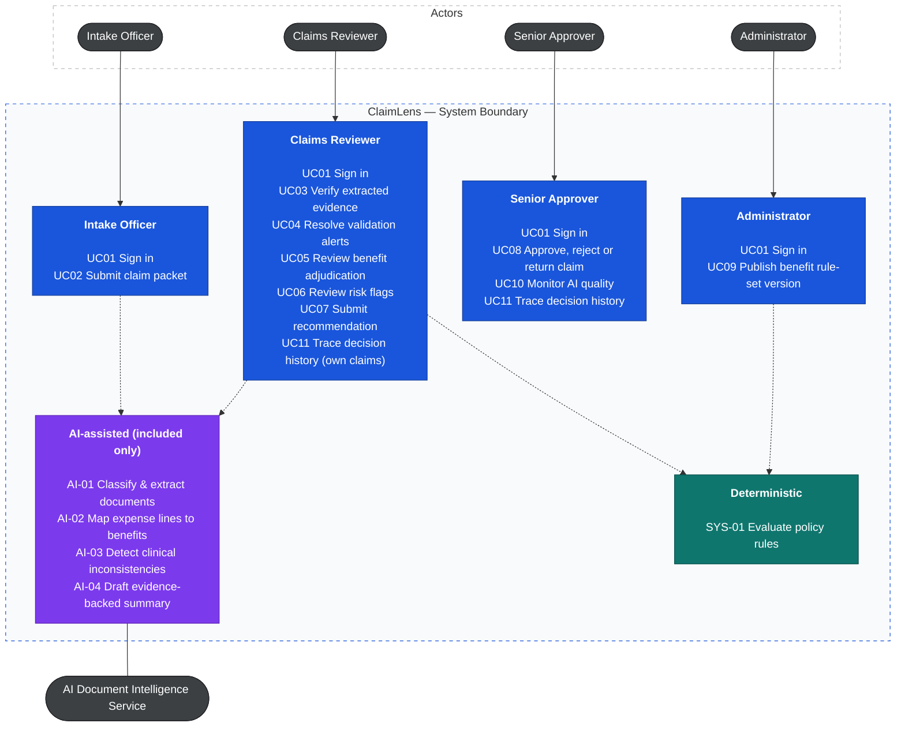
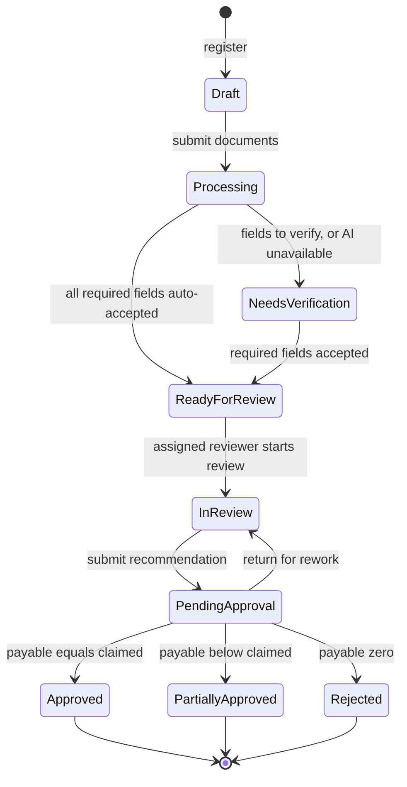
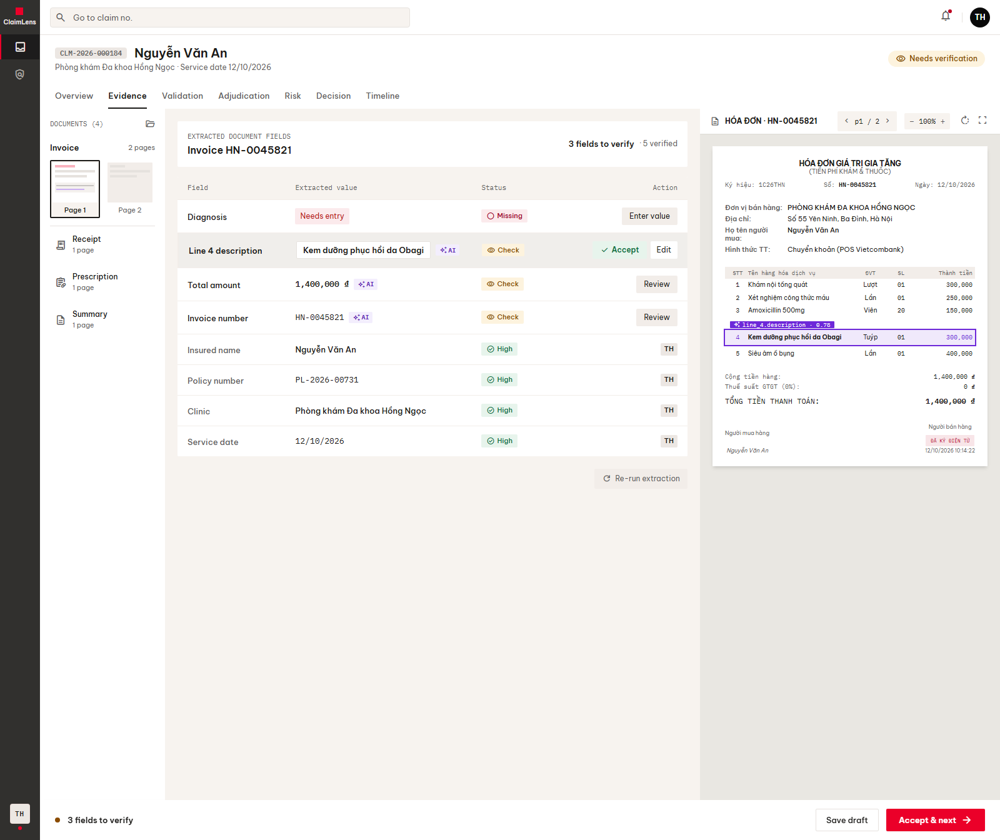
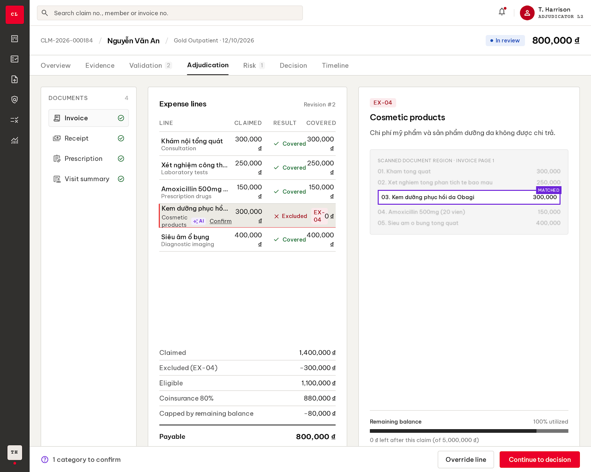
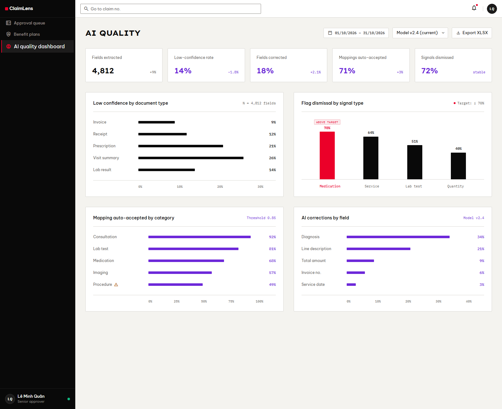

# ClaimLens

ClaimLens supports health insurance claim assessment, using AI to automatically classify and extract information from medical documents (images, DOCX, PDF and XLSX files), check that each claim is valid, detect anomalies, and recommend a claim settlement based on the policy's benefits and the insurer's criteria.

The whole product follows one rule: **AI reads, the Rule Engine calculates, people decide.**

## 1. Requirements: INVEST, use cases and acceptance criteria

This section covers what ClaimLens must do, who uses it, where AI is and is not allowed to help, and how we will know each feature works.

### 1.1 Feature map

The product is split into 10 feature areas, each broken down into functions. The image is exported from [02_Feature_Map.xmind](02_Feature_Map.xmind).


### 1.2 Who decides what

Each part of the system has a clear job and clear limits:

| Who | Does | Never does |
|---|---|---|
| **AI** (Document Intelligence Service) | Sorts pages, reads documents, matches free-text service names to benefit categories, spots medical inconsistencies, drafts explanations. | Decides coverage, calculates money, approves or rejects a claim, or labels anyone as a fraudster. |
| **Rule Engine** (fixed rules, same answer every time) | Checks eligibility, waiting periods and exclusions, applies the reimbursement rate and limits, and calculates the payable amount. The same rule-set version always gives the same result. | Reads documents or guesses missing values. |
| **People** (Reviewer, Senior Approver) | Check the evidence, resolve conflicts, override a result with a written reason, and make the final decision. | Approve their own recommendation. A different person must sign off (the "maker–checker" rule). |

**How sure is AI?** Everything AI produces is a suggestion with a confidence score (0 to 1) and a link to where it found the value. The score decides what happens next:

| AI output | Accepted as a suggestion | A person must check | Left blank for a person to type |
|---|---|---|---|
| Page type | 0.80 or higher | below 0.80 → marked "Unclassified" | — |
| Field value (general) | 0.90 or higher | 0.70–0.90 → "Needs verification" | below 0.70 → "Needs entry" |
| Field value (money and identity) | 0.95 or higher | 0.70–0.95 → "Needs verification" | below 0.70 → "Needs entry" |
| Expense line → benefit category | 0.85 or higher | below 0.85 → the reviewer confirms | — |

Even high-confidence values are not used blindly. Before submitting a recommendation, the reviewer confirms every AI value that feeds into the calculation, so no AI output reaches a decision without a person seeing it.

### 1.3 INVEST requirements

The MVP backlog has 23 user stories grouped into 9 epics. Before development starts, each story must pass the INVEST check:

| Criterion | What it means here |
|---|---|
| **Independent** | A story delivers one capability and depends on others only where the claim workflow demands it. |
| **Negotiable** | Layout and technical design may change; the AI / Rule Engine / People split and the business rules may not. |
| **Valuable** | A story saves reviewer time, prevents a wrong payment, or makes a decision easier to explain or audit. |
| **Estimable** | Roles, inputs, confidence thresholds, rule versions and failure cases are written down. |
| **Small** | A story covers one main capability and can be split into API, rule, AI, database, UI and test tasks. |
| **Testable** | Every story has Given / When / Then acceptance criteria, including who is allowed to do it, threshold behaviour and what happens when AI is down. |

| Stories | Epic |
|---|---|
| US01, US23 | E1 Access and routing |
| US02–US03 | E2 Intake |
| US04–US06 | E3 Document AI |
| US07–US09 | E4 Validation |
| US10–US13 | E5 Adjudication (deciding what is covered and how much to pay) |
| US14 | E6 Risk |
| US15–US18 | E7 Decision |
| US19–US20 | E8 Policy rules |
| US21–US22 | E9 AI oversight |

The first release contains all **Must** stories (18 stories, 85 points). The 5 **Should** stories (17 points) come in the next increment. Each of them can be done by hand in the meantime, so the product works without them. Eight stories use AI: US04, US05, US06, US09, US10, US14, US15 and US21.

The full backlog, acceptance criteria and the INVEST review of each story are in [INVEST Requirements](docs/08-invest-requirements.md).

### 1.4 Use cases

ClaimLens has four kinds of users. The diagram shows what each of them can do, and which steps get help from AI.



How to read it:

- **Nobody starts an AI step directly.** AI runs as part of a person's task (for example, extraction runs when a claim is submitted), and its output always goes to a person to check.
- **AI is kept out of** calculating benefits, checking eligibility, writing rules, approving claims and controlling access.
- Staff accounts, members and policies are pre-loaded test data in the MVP, so there are no screens to manage them.

The full UML diagram (with `«include»` / `«extend»` relationships), a description of each actor and the reasoning behind every place AI is used are in [Actors, roles, and use cases](docs/03-use-cases.md). A strict PlantUML version is in [use-case.puml](docs/diagrams/use-case.puml).

### 1.5 Roles and permissions

| Capability | Intake | Reviewer | Approver | Administrator |
|---|---|---|---|---|
| Register claims and upload documents | Yes | No | No | No |
| Verify evidence, resolve alerts, review adjudication | No | Yes | No | No |
| Override a line result (reason required) | No | Yes | No | No |
| Submit recommendation | No | Yes | No | No |
| Handle AI risk flags | No | Dismiss / keep | Read kept flags | No |
| Approve, partially approve, reject or return | No | No | Yes | No |
| Publish benefit rule sets | No | Read | Read | Yes |
| See medical and identity data | Claims they registered | Assigned claims | Yes | No |
| AI quality dashboard | No | No | Yes | No |
| Claim timeline | No | Own claims | Yes | No |

These permissions must be enforced by the backend, not just by hiding buttons in the UI. That covers role-based access, the maker–checker rule and who can see medical data (business rule BR-11). All 13 business rules (BR-01 to BR-13) are listed in [Actors, roles, and use cases](docs/03-use-cases.md#business-rules-referenced-by-use-cases).

### 1.6 Claim lifecycle

A claim moves through these statuses. It only goes to "Needs verification" when AI was unsure about something or AI was unavailable. Otherwise it goes straight to the review queue.



The requirements were audited from end to end. All 38 findings, how each was fixed and the later scope changes (down to four roles and 11 use cases) are in the [Audit report](docs/09-audit-report.md).

## 2. Information architecture, screen hierarchy and UI/UX

The app is organised around the claim. Each role lands on its own home page and only sees the menu items it can use (nothing is shown greyed out). Every screen handles the same set of states the same way: loading, empty, AI processing, AI unavailable, error and success.

### 2.1 Information architecture

```text
Public
└── Sign in

Authenticated
├── Work
│   ├── Intake                 (new claim stepper, submissions)
│   ├── Review queue           (available, assigned to me, needs verification, returned)
│   ├── Approval queue         (pending, decided by me)
│   └── Claim workspace        (overview, evidence, validation, adjudication, risk, decision, timeline)
├── Policy
│   └── Benefit plans          (versions, rule set editor, test run)
├── Insights
│   └── AI quality dashboard
├── Profile
└── 403 / 404
```

The sitemap below shows all 19 pages, their sections and the tasks done on each. Sections that use AI are shown in violet. Its source is [ia-sitemap.html](docs/diagrams/ia-sitemap.html), and the list of pages and tasks is in [Relume sitemap input](docs/relume-sitemap.md).


### 2.2 Screen hierarchy

After signing in, every page shares the same frame: a sidebar on the left, a top bar with a claim-number search, and the content area.

The main screen is the **Claim workspace**, split into three columns:

- **Left:** the claim's documents.
- **Middle:** the current task (evidence, adjudication, decision and so on).
- **Right:** context. Select a value in the middle and the right column jumps to the spot on the scan where it came from.

Overrides open in a side drawer; risk-flag actions and decisions open in a dialog.

AI output looks the same everywhere, so reviewers always know what came from AI:

- an **✦ AI** marker on every AI-produced value;
- a confidence level: **High**, **Check** or **Missing**;
- a **source pin** linking the value to its place on the document;
- risk flags worded as a **"signal, not a finding"**, never an accusation;
- **citation chips** after each sentence of an AI-drafted summary;
- a **fallback banner** when AI is down, so the work can continue by hand.

Routes, the screen inventory (SCR-01 to SCR-90), task flows, the UI state rules, accessibility rules and which API each screen calls are in [Information Architecture](docs/04-information-architecture.md).

### 2.3 Design system

The screens are generated with [Google Stitch](https://stitch.withgoogle.com) from a design system written in Stitch's `DESIGN.md` format.

The look is "ink on paper": black text on a warm off-white background, flat panels separated by thin 1 px lines, nearly square corners and a compact layout for people who spend all day in the tool. Colour is used sparingly, so it means something:

- **Signal Red** marks the one main action on a screen;
- **Insight Violet** is used only for AI.

Fonts are Lexend Exa for short uppercase headings and KPI numbers, Be Vietnam Pro for body text (it renders Vietnamese names correctly) and IBM Plex Mono for amounts and codes. All text meets WCAG AA contrast.

- [UI brief and locked decisions](docs/05-ui-brief-stitch.md)
- [DESIGN.md](docs/DESIGN.md)
- [Stitch prompts and review rounds](docs/stitch-prompts.md)

### 2.4 Current UI prototype

#### Sign in


#### Upload documents, with AI checking each page


#### Review queue


#### Claim workspace: Evidence

The reviewer checks AI-extracted values next to the highlighted spot on the invoice.



#### Claim workspace: Adjudication

Each expense line with its result and rule code, and the payout calculation.



#### AI quality dashboard



The Decision screen (SCR-35) is still being polished in Stitch. For SCR-13, 20, 33 and 50, the `.html` files in [docs/ui](docs/ui/) are the up-to-date version: the fonts were corrected there after the `.png` screenshots were taken.

## 3. Architecture and technology direction

The C4 model, database design and API contract are not designed yet. Product research points to this direction:

```text
Frontend          Next.js (React) staff web app
Backend           .NET or Spring Boot API with a deterministic Rule Engine
Database          PostgreSQL (claims, versioned rule sets, calculation revisions, audit events)
File storage      Object storage for claim documents
Document AI       Python service for OCR, page classification, extraction and mapping
Background jobs   Document processing, re-runs and information-request deadlines
```

## Documentation

- **Research:** [Product research](01_Product_Research.xmind), [Feature map](02_Feature_Map.xmind).
- **Requirements:** [Actors, roles, use cases and business rules](docs/03-use-cases.md), [INVEST backlog and acceptance criteria](docs/08-invest-requirements.md), [Audit report](docs/09-audit-report.md).
- **Diagrams:** [Use case diagram (PlantUML)](docs/diagrams/use-case.puml).
- **UI/UX:** [Information architecture](docs/04-information-architecture.md), [UI brief](docs/05-ui-brief-stitch.md), [DESIGN.md](docs/DESIGN.md), [Stitch prompts](docs/stitch-prompts.md), [screens](docs/ui/).

## Project progress

- [x] Research the product, workflow and AI opportunities (mind maps)
- [x] Define scope, actors and user roles
- [x] Define the AI / Rule Engine / People boundary and confidence thresholds
- [x] Write use cases and the use case diagram (Mermaid and PlantUML)
- [x] Write user stories following INVEST with Given/When/Then acceptance criteria
- [x] Write business rules and the claim lifecycle
- [x] Audit requirements and trace use cases, stories, rules and screens
- [x] Design the information architecture, screen inventory, task flows and UI states
- [x] Write the design system (DESIGN.md) and Stitch prompts
- [ ] Generate the UI prototype in Stitch (6 of 7 priority screens done; Decision still in progress)
- [ ] Render-check the PlantUML use case diagram
- [ ] Write non-functional requirements
- [ ] Design the C4 System Context, Container and Component views
- [ ] Design the PostgreSQL schema and ER diagram
- [ ] Write the API contract in OpenAPI 3.0
- [ ] Design the frontend and backend folder structures
- [ ] Design class diagrams and sequence diagrams
- [ ] Build the backend, Rule Engine and Document AI service
- [ ] Build the frontend and connect it to the API
