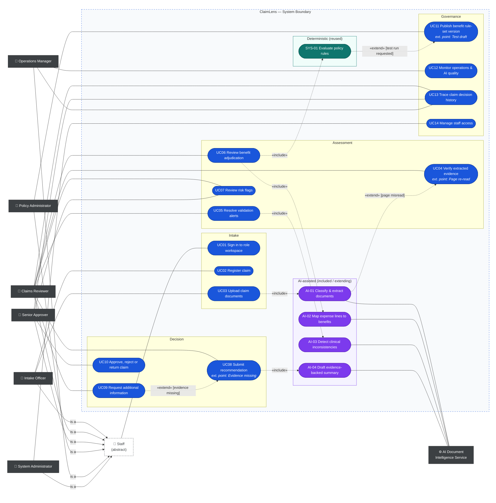
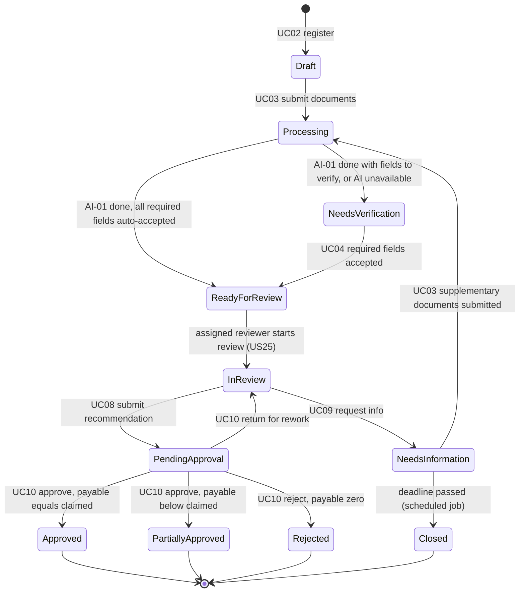

# Actors, Roles & Use Cases

> Design status: TARGET MVP
>
> Scope: outpatient reimbursement claims, one insured person per claim, multiple expense lines.

Product name: **ClaimLens** — an evidence-grounded, AI-assisted health insurance claims adjudication workbench.

## Design principle: who decides what

| Layer | Owns | Never does |
|---|---|---|
| **AI** (Document Intelligence Service) | Perception and language: classify pages, read documents, normalize terms, notice clinical inconsistencies, draft explanations. | Decide coverage, compute money, approve or reject, label a person as fraudulent. |
| **Rule Engine** (deterministic, inside the system) | Eligibility, waiting period, exclusions, reimbursement rate, limits, payable amount — reproducible for a given policy version. | Read unstructured documents or guess missing values. |
| **Human** (Reviewer, Senior Approver) | Verifying evidence, resolving conflicts, overriding with reason, final decision. | Approve their own recommendation (maker–checker). |

Every AI output is a **suggestion with a confidence and a source location**. A suggestion at or above its threshold becomes an **auto-accepted suggestion**: it counts as accepted for workflow gates, keeps its AI marker until a person touches it, and is audited with `acceptedBy = threshold`. Below the threshold a person must accept it. Before a recommendation is submitted, the reviewer attests to every auto-accepted value used in the calculation (UC08), so no AI value reaches a decision without a human seeing it.

### Confidence thresholds (BR-03)

| AI output | Auto-accepted suggestion | Needs a person | Left empty |
|---|---|---|---|
| Page type | ≥ 0.80 | < 0.80 → "Unclassified", type must be chosen | — |
| Field value (general) | ≥ 0.90 | 0.70 ≤ c < 0.90 → "Needs verification" | < 0.70 → "Needs entry" |
| Field value (money & identity: insured name, ID number, policy number, invoice total, line amount) | ≥ 0.95 | 0.70 ≤ c < 0.95 → "Needs verification" | < 0.70 → "Needs entry" |
| Expense line → benefit category | ≥ 0.85 | < 0.85 → reviewer confirms before adjudication | — |

Thresholds are seed configuration per field group; there is no threshold UI in the MVP.

## Actors

| Actor | Type | Role code | Responsibility |
|---|---|---|---|
| Intake Officer | Primary | `INTAKE_OFFICER` | Registers claims, links the policy, uploads the claim packet and supplementary documents. |
| Claims Reviewer | Primary | `CLAIMS_REVIEWER` | Picks up claims, verifies evidence, resolves alerts, prepares the recommendation. |
| Senior Approver | Primary | `SENIOR_APPROVER` | Approves, rejects or returns recommendations; escalates flags for investigation. |
| Policy Administrator | Primary | `POLICY_ADMIN` | Maintains versioned benefit rule sets. Member and policy data are seeded in the MVP. |
| Operations Manager | Primary | `OPS_MANAGER` | Monitors throughput, backlog, AI quality and audit history (medical data masked). |
| System Administrator | Primary | `SYSTEM_ADMIN` | Manages staff accounts, role assignment and the access log; sees no claim content. |
| Staff | Abstract (generalization) | — | Parent of all six roles; carries UC01. |
| AI Document Intelligence Service | Secondary (system) | — | OCR, page classification, quality check, extraction, term normalization, clinical consistency signals, summary drafts. |

The Policyholder is an indirect beneficiary and has no portal in the MVP.

## Use Case Diagram

Main use cases are user-goal level. **AI use cases (purple)** are never started by a person directly — they are `«include»`d by a business use case or `«extend»` one at a declared extension point, and always lead into a human verification step. **SYS-01 (teal)** is deterministic and reused by UC06 and UC11.

Notation: plain lines are actor–use case associations; the solid arrow labelled *is a* is generalization (child → parent); dotted arrows are `«include»` (base → included) and `«extend»` (extension → base, with the condition in brackets). Every role inherits UC01 from **Staff**. Audit logging is not a use case — it is the cross-cutting rule BR-12. A strict UML version is in [diagrams/use-case.puml](diagrams/use-case.puml).

### Why these AI placements

| AI use case | Relationship | Why AI is the right tool here | Why it stops where it stops |
|---|---|---|---|
| AI-01 Classify & extract | Included by UC03 (page check on upload, extraction after submit); extends UC04 at *Page re-read* | Receipts and invoices are unstructured photos and scans; no rule can read them. | Values below the threshold are left **empty or marked for verification**, never guessed. |
| AI-02 Map expense lines to benefits | Included by UC06 | Hospitals write "Siêu âm ổ bụng tổng quát", "SA bụng", "Abdominal US" — mapping free text to a benefit category is a language problem. | The mapping only feeds the Rule Engine; the Rule Engine alone decides coverage and money. Auto-accepted mappings are attested in UC08. |
| AI-03 Detect clinical inconsistencies | Included by UC05; its flags are handled in UC07 | Mismatches such as "diagnosis: gastritis, drug: insulin" need medical-language judgment. | Produces a **risk flag with evidence**, never a fraud verdict; a person dismisses, keeps or escalates. |
| AI-04 Draft evidence-backed summary | Included by UC08 | Reviewers lose time writing the same explanation; drafting from structured results is a language task. | Drafts only cite facts already in the case; the reviewer edits and signs it. |

Deliberately **no AI** in: benefit calculation, eligibility, rule authoring (UC11), approval (UC10), access control, request letters (UC09 uses a template). Later phases: policy clause-to-rule generation, document-alteration detection.

### AI placement matrix

| AI capability | Output | Confidence handling | Human checkpoint | Fallback when AI is unavailable | Measured by |
|---|---|---|---|---|---|
| Page classification | Document type per page | < 0.80 → "Unclassified" | UC03 (Intake may choose), UC04 (Reviewer must choose) | All pages "Unclassified"; types chosen manually | Macro-F1 |
| Quality check | Readable / blurry / cropped | Quality score below configured threshold → "Low quality", re-capture hint | UC03 | Officer judges quality | Re-upload rate |
| Field extraction | Value + page + bounding box | Per the threshold table | UC04 | Manual entry beside the document viewer | Field exact-match / F1, citation correctness |
| Expense → benefit mapping | Benefit category + confidence | < 0.85 → reviewer confirms mapping | UC06, attestation in UC08 | Reviewer selects category | Mapping accuracy |
| Clinical consistency signals | Risk flag + evidence + reason | Always requires human action | UC07 | "Clinical check not run" shown | False-positive rate |
| Review summary draft | Editable text with citations | Cites only accepted facts | UC08 | Reviewer writes from a structured template | Edit distance, reviewer acceptance |

## Role × use case matrix

| Use case | Intake | Reviewer | Approver | Policy Admin | Ops Mgr | Sys Admin |
|---|---|---|---|---|---|---|
| UC01 Sign in | ✓ | ✓ | ✓ | ✓ | ✓ | ✓ |
| UC02 Register claim | ✓ | | | | | |
| UC03 Upload documents | ✓ (incl. supplementary) | | | | | |
| UC04 Verify extracted evidence | | ✓ | | | | |
| UC05 Resolve validation alerts | | ✓ | | | | |
| UC06 Review benefit adjudication | | ✓ | | | | |
| UC07 Review risk flags | | ✓ (dismiss / keep) | ✓ (escalate) | | | |
| UC08 Submit recommendation | | ✓ | | | | |
| UC09 Request additional information | | ✓ | | | | |
| UC10 Approve / reject / return | | | ✓ | | | |
| UC11 Publish benefit rule-set version | | | | ✓ | | |
| UC12 Monitor operations & AI quality | | | | | ✓ | |
| UC13 Trace decision history | | own claims | ✓ | | ✓ (masked) | |
| UC14 Manage staff access | | | | | | ✓ (incl. access log) |

Menus and actions are not rendered without permission; the API enforces RBAC independently. "Masked" means medical and identity values are replaced by placeholders (BR-11).

## Claim lifecycle

- Assignment is an attribute, not a state: a reviewer self-assigns a claim in `NeedsVerification` or `ReadyForReview` (US25). An assigned claim that reaches `ReadyForReview` moves straight on to `InReview`.
- Requesting information requires an assigned claim in `InReview`. A Senior Approver who finds evidence missing returns the claim with a comment instead (UC10).
- Any data correction in `InReview` re-runs validation (UC05) and adjudication (UC06) and creates a new calculation revision; earlier revisions remain readable.
- **Returned** (review queue tab) = `InReview` with a return comment. **Escalated** (approval queue tab) = `PendingApproval` with an investigation marker. Neither is a separate state.
- `Closed` is not a decision: no benefit is consumed and no approver action is needed (BR-01 does not apply).

## Business rules referenced by use cases

| ID | Rule |
|---|---|
| BR-01 | No claim is approved, partially approved or rejected without a Senior Approver action. AI and the Rule Engine never decide an outcome. |
| BR-02 | Every extracted value stores document, page and bounding region. A value without a source cannot be accepted. |
| BR-03 | AI outputs follow the confidence threshold table above; thresholds are seed configuration per field group. Auto-accepted suggestions keep their AI marker and are attested before submission. |
| BR-04 | Adjudication uses the rule-set version effective on the **service date**, not the processing date. |
| BR-05 | Line result ∈ {Covered, Partially covered, Excluded}, each with a rule code. Payable = min(Σ covered amount × reimbursement rate, remaining limit), where remaining limit = min(per-visit limit, annual limit − consumed balance). The order of application is defined by the rule set. "Reimbursement rate 80%" means the insurer pays 80% and the insured co-pays 20%. |
| BR-06 | Maker–checker: the person who submitted a recommendation cannot decide it. (One role per account already separates duties; the check is defence in depth.) |
| BR-07 | Every override and every dismissed alert or flag requires a reason code and free-text note. An override cannot exceed the claimed line amount, and the payable stays capped by the remaining limit (BR-05). |
| BR-08 | Deterministic problems are **Alerts** (Validation). AI signals and near-duplicates are **Risk flags** (Risk). A risk flag is a signal, not a fraud finding. Only a Senior Approver escalates a flag; the investigation itself is outside the MVP. |
| BR-09 | Approval queue priority: payable ≥ high-value threshold (seed value 5,000,000 VND), then open High flags, then age. Every recommendation still requires a Senior Approver (BR-01). |
| BR-10 | Benefit balance is consumed only when a claim is approved; pending claims show a projected balance. At decision time the system re-checks the remaining balance; if it changed since the calculation revision, approval is blocked until adjudication is re-run. |
| BR-11 | Medical documents, medical field values and identity data are visible only to roles working on the claim (Intake Officer who registered it, assigned Reviewer, Senior Approvers). Operations Manager sees them masked; System Administrator sees no claim content. |
| BR-12 | Every state change, field correction, override, dismissal, decision and access to claim data writes an immutable audit event with actor and time. |
| BR-13 | Outcome by amount: **Approved** when payable = claimed total; **PartiallyApproved** when 0 < payable < claimed total; **Rejected** when payable = 0 (reason code required). A recommendation type that differs from this requires a reason. |

## Use case specifications

Every specification uses the same template: Actor · Secondary · Goal · Trigger · Preconditions · Main flow · Alternatives · Exceptions · Postconditions · Rules · Stories · Screens.

### UC01 Sign in to role workspace

- **Actor:** any Staff (inherited by all six roles). Subfunction level — kept because it routes each role to its queue.
- **Goal:** reach the workspace and queue that match the assigned role.
- **Trigger:** user opens ClaimLens.
- **Preconditions:** an active staff account with exactly one role.
- **Main flow:** enter email and password → system verifies credentials and active status → returns access token and role → opens the role's home (Intake: Intake; Reviewer: Review queue; Approver: Approval queue; Policy Admin: Benefit plans; Ops: Operations dashboard — Audit log while US23 is not released; Sys Admin: Staff accounts).
- **Exceptions:** invalid credentials or disabled account → same generic error, no account state disclosed. Protected URL without permission → 403 page with a route back to the role home.
- **Postconditions:** session established; sign-in recorded in the access log.
- **Rules:** BR-11, BR-12.
- **Stories:** US01, US25. **Screens:** SCR-01, SCR-20, SCR-22, SCR-90.

### UC02 Register claim

- **Actor:** Intake Officer
- **Goal:** create a claim case linked to the correct member and policy.
- **Trigger:** a claim packet arrives from a policyholder.
- **Preconditions:** member and policy exist (seeded in the MVP).
- **Main flow:** search member by name, ID number or policy number → system shows policy status, coverage period and remaining outpatient balance → officer enters service date, provider, claimed total and channel → system creates claim in `Draft`.
- **Alternatives:** service date outside coverage period → warning shown; the claim can still be registered; the Rule Engine will mark its lines Excluded with a cited rule code, and rejection still requires a Senior Approver (BR-01).
- **Exceptions:** no member found → "No member found" with search hints; a claim cannot be created without member and policy. Policy lapsed → shown as status; registration allowed with warning.
- **Postconditions:** claim number generated; status `Draft`; audit event recorded.
- **Rules:** BR-01, BR-12.
- **Stories:** US03. **Screens:** SCR-10, SCR-11, SCR-12, SCR-40.

### UC03 Upload claim documents

- **Actor:** Intake Officer
- **Secondary:** AI Document Intelligence Service
- **Goal:** attach the claim packet (or supplementary documents) and start automatic processing.
- **Trigger:** claim in `Draft` after registration, or claim in `NeedsInformation` when the policyholder sends more documents.
- **Preconditions:** claim exists in `Draft` or `NeedsInformation`.
- **Main flow:** drop PDF / JPG / PNG files (≤ 20 MB each, ≤ 30 pages per claim) → system stores originals and splits pages → **AI-01 page check** classifies each page and checks readability (before submission) → officer reviews page types and quality → submits → claim moves to `Processing` → **AI-01 extraction** reads fields with source regions → claim moves to `NeedsVerification` or `ReadyForReview`.
- **Alternatives:**
  - A page is "Low quality" → re-capture hint; the officer may replace it; submission is still allowed.
  - A page is "Unclassified" → the officer may choose a type; otherwise the reviewer must choose it in UC04.
  - Supplementary documents (claim in `NeedsInformation`) → opened from the Intake *Needs information* tab; only new pages are processed; verified fields on earlier pages are kept.
- **Exceptions:** unsupported file type or size → file rejected with the reason. AI service unavailable → pages "Unclassified", claim moves to `NeedsVerification` with empty fields for manual entry.
- **Postconditions:** originals stored; claim in `Processing`, then `NeedsVerification` or `ReadyForReview`; audit event recorded.
- **Rules:** BR-02, BR-03, BR-12.
- **Stories:** US04, US05, US06, US19. **Screens:** SCR-10, SCR-13.

### UC04 Verify extracted evidence

- **Actor:** Claims Reviewer
- **Goal:** make every claim fact trustworthy before rules run.
- **Trigger:** reviewer opens an assigned claim with fields to verify.
- **Preconditions:** claim assigned to the reviewer (US25); extraction run finished or failed.
- **Main flow:** open the Evidence tab → fields grouped by document, sorted by lowest confidence → clicking a field highlights its region in the document viewer → reviewer accepts, edits or marks "Not present" → system records who changed what from which value; the AI marker is replaced by the reviewer's initials.
- **Extension point *Page re-read*:** `[page misclassified or unreadable]` → reviewer reclassifies the page and **AI-01** re-reads that page only; verified fields on other pages are kept.
- **Alternatives:** AI unavailable → reviewer enters fields manually beside the viewer.
- **Exceptions:** a value without a source region cannot be accepted (BR-02) → reviewer must draw a region or mark "Not present".
- **Postconditions:** all required fields accepted (auto-accepted or by a person) → claim `ReadyForReview`, then `InReview` because it is assigned; downstream checks re-run.
- **Rules:** BR-02, BR-03, BR-07, BR-11, BR-12.
- **Stories:** US06, US07. **Screens:** SCR-31.

### UC05 Resolve validation alerts

- **Actor:** Claims Reviewer
- **Secondary:** AI Document Intelligence Service (via AI-03)
- **Goal:** know the packet is complete, consistent and not a duplicate before money is computed.
- **Trigger:** required fields accepted, or any field changed in `InReview`.
- **Preconditions:** claim in `InReview`, assigned to the reviewer.
- **Main flow:** system runs deterministic checks — required documents present, insured name and policy match, dates consistent across documents, invoice total equals sum of lines, invoice number + provider not used in another claim — and raises **Alerts** (Blocking / Warning) with evidence → system runs **AI-03** for clinical consistency (diagnosis vs. medication and services); its output and near-duplicates become **Risk flags** handled in UC07 → reviewer resolves each alert (fix data) or dismisses it with reason.
- **Alternatives:** evidence missing → reviewer requests information (UC09).
- **Exceptions:** AI service unavailable → no clinical flags; claim shows "Clinical check not run"; validation continues.
- **Postconditions:** no open Blocking alert → adjudication can run.
- **Rules:** BR-07, BR-08, BR-12.
- **Stories:** US08, US09, US10, US14. **Screens:** SCR-32.

### UC06 Review benefit adjudication

- **Actor:** Claims Reviewer
- **Secondary:** AI Document Intelligence Service (via AI-02)
- **Goal:** obtain an explainable per-line payment proposal.
- **Trigger:** no open Blocking alert.
- **Preconditions:** claim in `InReview`; a rule-set version is published for the member's plan.
- **Main flow:** **AI-02** maps each expense line to a benefit category with confidence → reviewer confirms mappings below 0.85 → **SYS-01** loads the rule-set version effective on the service date and evaluates eligibility, waiting period, exclusions, reimbursement rate and limits per line → system shows, per line: result, covered amount, rule code, clause text and formula; and the claim total with remaining balance before and projected after.
- **Alternatives:** mapping corrected or data edited → recalculation creates a new revision. AI unavailable → reviewer selects every category manually.
- **Exceptions:** no rule-set version effective on the service date → adjudication blocked with "No effective rule set"; Policy Administrator named as owner.
- **Example (golden case):** Consultation 200,000, Lab test 500,000, Medication 400,000 Covered; Cosmetic service 300,000 Excluded by EX-04 → claimed 1,400,000, eligible 1,100,000 → × 80% = 880,000 → remaining limit 800,000 → **payable = min(880,000; 800,000) = 800,000 VND**; projected balance after = 0.
- **Postconditions:** a numbered calculation revision exists.
- **Rules:** BR-04, BR-05, BR-10.
- **Stories:** US11, US12, US13, US14. **Screens:** SCR-33.

### UC07 Review risk flags

- **Actors:** Claims Reviewer, Senior Approver
- **Goal:** decide what each anomaly means for this claim.
- **Trigger:** a claim has open risk flags (from AI-03, near-duplicate rule, or manual).
- **Preconditions:** claim in `InReview` (reviewer) or `PendingApproval` (approver).
- **Main flow (Reviewer):** open the Risk tab → each flag shows type, severity, source (AI or rule), evidence (side-by-side documents, matching claim) and reason; AI flags are labelled "Signal — not a finding" → reviewer dismisses with reason, or keeps it for the approver with a note → reviewer may add a manual flag.
- **Alternative (Senior Approver):** escalate a kept flag for investigation with reason → claim stays `PendingApproval` with the *Escalated* marker and appears in the Escalated tab.
- **Exceptions:** dismiss or escalate without reason code and note → blocked.
- **Postconditions:** every flag is dismissed, kept or escalated, with an audit event.
- **Rules:** BR-07, BR-08, BR-12.
- **Stories:** US15, US20. **Screens:** SCR-34.

### UC08 Submit recommendation

- **Actor:** Claims Reviewer
- **Secondary:** AI Document Intelligence Service (via AI-04)
- **Goal:** hand a complete, justified decision proposal to the approver.
- **Trigger:** adjudication result available.
- **Preconditions:** claim in `InReview`; no open Blocking alert; all mappings below 0.85 confirmed.
- **Main flow:** review adjudication result → optionally override a line (new amount or result, reason code, note) → **AI-04** drafts a summary that cites accepted facts, rule codes, overrides and open flags → reviewer edits the summary → system proposes the recommendation type from the payable (BR-13) → reviewer confirms or changes it with a reason → reviewer attests the auto-accepted AI values used in the calculation → submits → claim `PendingApproval`.
- **Extension point *Evidence missing*:** UC09.
- **Alternatives:** AI unavailable → summary box shows a structured template.
- **Exceptions:** an open High flag → warning; the flag is shown to the approver. Any precondition missing → Submit disabled with the missing item named.
- **Postconditions:** claim in `PendingApproval` in the approval queue by priority (BR-09).
- **Rules:** BR-03, BR-06, BR-07, BR-09, BR-13.
- **Stories:** US16, US17, US18. **Screens:** SCR-30, SCR-35, SCR-38.

### UC09 Request additional information

- **Actor:** Claims Reviewer
- **Goal:** get the documents needed to decide.
- **Trigger:** evidence missing or unclear (from UC05 or UC08).
- **Preconditions:** claim in `InReview`, assigned to the reviewer.
- **Main flow:** select missing or unclear items (pre-filled from open validation alerts) → set a response deadline → system produces a request letter from a template (no AI) → claim `NeedsInformation` → the Intake Officer uploads the supplementary documents (UC03) → claim returns to `Processing`.
- **Alternatives:** reviewer extends the deadline before it passes.
- **Exceptions:** deadline passes without new documents → a scheduled job moves the claim to `Closed` with an audit event.
- **Postconditions:** request recorded and exportable as PDF; sending to the policyholder happens outside the system in the MVP.
- **Rules:** BR-12.
- **Stories:** US19. **Screens:** SCR-37, SCR-10 (Needs information tab).

### UC10 Approve, reject or return claim

- **Actor:** Senior Approver
- **Goal:** take an accountable final decision.
- **Trigger:** claim in the approval queue.
- **Preconditions:** claim in `PendingApproval`; the approver did not submit the recommendation.
- **Main flow:** open approval queue → see recommendation, payable amount, line results, overrides, attested AI values, open flags and summary → approve, partially approve or reject (outcome per BR-13; reject needs a reason code) → confirmation shows claim number, outcome and final amount → system re-checks the remaining balance → records the decision with rule-set version and calculation revision → benefit balance consumed on approval.
- **Alternatives:** return to reviewer with a comment (also used when evidence is missing) → claim `InReview`, shown in the reviewer's Returned tab. Escalate a flag (UC07).
- **Exceptions:** approver is the submitter → actions disabled with explanation (BR-06). Remaining balance changed since the calculation revision → approval blocked until adjudication is re-run (BR-10).
- **Postconditions:** claim `Approved`, `PartiallyApproved`, `Rejected` or back in `InReview`; audit event recorded.
- **Rules:** BR-01, BR-06, BR-09, BR-10, BR-12, BR-13.
- **Stories:** US20. **Screens:** SCR-21, SCR-30, SCR-35, SCR-39.

### UC11 Publish benefit rule-set version

- **Actor:** Policy Administrator
- **Goal:** keep coverage logic accurate without rewriting old decisions.
- **Trigger:** a plan's contract terms change, or a new plan is introduced.
- **Preconditions:** benefit plan exists.
- **Main flow:** create a draft version of a benefit plan → configure covered categories, exclusions, waiting periods, reimbursement rate, per-visit and annual limits, each with a rule code and clause text → publish with an effective-from date.
- **Extension point *Test draft*:** `[test run requested]` → **SYS-01** runs selected sample claims through the draft and shows results next to the current version with differences highlighted.
- **Exceptions:** effective-from date not later than the current version's → publish blocked. Editing a published version → not allowed; create a new version instead.
- **Postconditions:** published version is immutable; claims with service dates from the effective-from date use it.
- **Rules:** BR-04, BR-05, BR-12.
- **Stories:** US21, US22. **Screens:** SCR-41, SCR-42, SCR-43.

### UC12 Monitor operations & AI quality

- **Actor:** Operations Manager
- **Goal:** balance workload and judge whether AI is helping.
- **Trigger:** routine monitoring.
- **Preconditions:** none beyond sign-in.
- **Main flow:** view claims by status, backlog age, median handling time, outcomes, reviewer workload, AI low-confidence rate, correction rate by field, flag dismissal rate → filter by date range and plan → drill down to claims (masked) → export report.
- **Exceptions:** no data for filters → empty state distinguishes "no claims" from "no results".
- **Postconditions:** none (read-only).
- **Rules:** BR-11.
- **Stories:** US23. **Screens:** SCR-50, SCR-51.

### UC13 Trace claim decision history

- **Actors:** Senior Approver, Operations Manager (masked), Claims Reviewer (own claims)
- **Goal:** reconstruct how any outcome was reached.
- **Trigger:** a question about a claim's outcome (complaint, audit, quality check).
- **Preconditions:** the user may see the claim (BR-11).
- **Main flow:** open the claim (search or queue) → Timeline tab: status changes, uploads, field corrections (before/after), AI runs and model versions, rule-set version, calculation revisions, overrides, flags and decision, each with actor and time.
- **Exceptions:** claim outside the user's scope → 403.
- **Postconditions:** the access is itself audited (BR-12).
- **Rules:** BR-11, BR-12.
- **Stories:** US24. **Screens:** SCR-22, SCR-36, SCR-52.

### UC14 Manage staff access

- **Actor:** System Administrator
- **Goal:** only authorised people handle claims and medical data.
- **Trigger:** staff joins, leaves or changes job.
- **Preconditions:** none beyond sign-in.
- **Main flow:** list staff → create, edit or disable an account → assign exactly one role → view the access log (sign-ins, role changes, claim-open events by claim number only).
- **Exceptions:** disabling one's own account → blocked.
- **Postconditions:** change effective at the user's next request; audit event with before/after role.
- **Rules:** BR-11, BR-12.
- **Stories:** US02. **Screens:** SCR-60, SCR-52.

**Related:** [User stories](08-invest-requirements.md) · [Information architecture](04-information-architecture.md) · [Audit report](09-audit-report.md)
