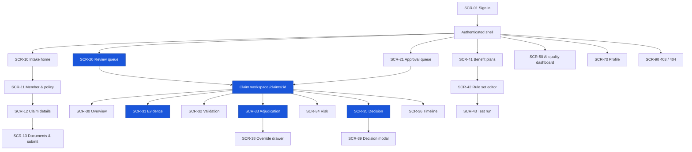
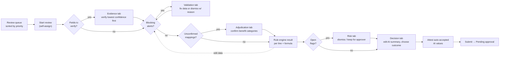
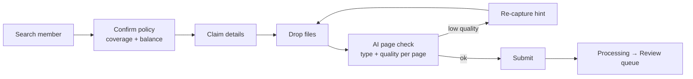
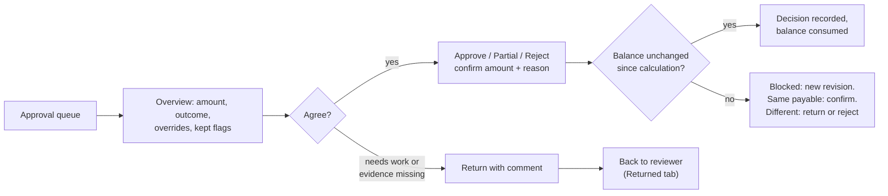

# Information Architecture

> Design status: TARGET MVP
>
> Platform: web, desktop-first (1440 px reference; usable down to 1280 px). Tablet/mobile are read-only fallbacks, not primary targets.

The IA is organised around **one claim case** and **one work queue per role**. Staff should never hunt for work: each role signs in to its queue, opens a case, and finishes it in a single workspace.

## Sitemap

A visual sitemap with the sections and tasks of every page is in [images/ia-sitemap-relume.png](images/ia-sitemap-relume.png) (source: [diagrams/ia-sitemap.html](diagrams/ia-sitemap.html)).

```text
ClaimLens
│
├── Public
│   └── Sign in                                   /sign-in
│
└── Authenticated (left sidebar + top bar)
    │
    ├── Work
    │   ├── Intake                                /intake                    Intake Officer
    │   │   ├── New claim (stepper)               /intake/new
    │   │   │   ├── 1 Member & policy
    │   │   │   ├── 2 Claim details
    │   │   │   └── 3 Documents & submit          /intake/:claimId
    │   │   └── My submissions                    /intake?tab=submitted
    │   │
    │   ├── Review queue                          /queue                     Claims Reviewer
    │   │   └── tabs: Available · Assigned to me · Needs verification · Returned
    │   │
    │   ├── Approval queue                        /approvals                 Senior Approver
    │   │   └── tabs: Pending · Decided by me
    │   │
    │   └── Claim workspace                       /claims/:id                Reviewer, Approver (scoped by BR-11)
    │       ├── Overview                          /claims/:id/overview
    │       ├── Documents & evidence              /claims/:id/evidence
    │       ├── Validation                        /claims/:id/validation
    │       ├── Adjudication                      /claims/:id/adjudication
    │       ├── Risk                              /claims/:id/risk
    │       ├── Decision                          /claims/:id/decision
    │       ├── Timeline                          /claims/:id/timeline
    │       └── (drawers / modals)
    │           ├── Override line                 drawer
    │           ├── Dismiss / keep flag           modal
    │           └── Approve · Reject · Return     modal
    │
    ├── Policy
    │   └── Benefit plans                         /plans                     Administrator (Reviewer, Approver read)
    │       └── Plan                              /plans/:id (opens Versions)
    │           ├── Versions                      /plans/:id/versions
    │           ├── Rule set editor (draft)       /plans/:id/versions/:versionId
    │           │   └── tabs: Categories · Exclusions · Waiting periods · Coinsurance · Limits
    │           └── Test run                      /plans/:id/versions/:versionId/test
    │
    ├── Insights
    │   └── AI quality dashboard                  /insights/ai-quality       Senior Approver
    │
    ├── Profile                                   /profile                   all
    └── 403 / 404                                 /403  /404
```

Staff accounts, members and policies are seeded in the MVP, so there are no administration or member pages. Member search lives in step 1 of the New claim stepper.

The claim is created at the end of step 2, so step 3 has its own route, `/intake/:claimId`. That is also where a draft reopens from the Drafts tab, and where My submissions opens a submitted claim: read-only, with the claim header and documents but no extracted fields (BR-11). `:versionId` is the UUID the API uses; the screen shows it as `v3`. How these routes map to folders is in [Code structure](10-code-structure.md#routes).

## Navigation model

Global shell: **left sidebar** (collapsible, icon + label) · **top bar** (go to a claim by claim no., profile) · **content area**.

Sidebar items are rendered per role — never shown disabled.

| Sidebar group | Item | Intake | Reviewer | Approver | Administrator |
|---|---|---|---|---|---|
| Work | Intake | ● home | | | |
| Work | Review queue | | ● home | | |
| Work | Approval queue | | | ● home | |
| Policy | Benefit plans | | read | read | ● home |
| Insights | AI quality dashboard | | | ✓ | |

● = landing page after sign-in (US01). Every home screen is in the Must release.

Data visibility follows BR-11: medical and identity values are shown only to the Intake Officer who registered the claim, the assigned Reviewer and Senior Approvers; the Administrator never opens claim content. The Available tab shows a reviewer each unassigned claim's number, plan, service date, claimed total, status and age, with no member name, until they click Start review.

## The core screen: Claim workspace

The Claim workspace is where ~80 % of reviewer time is spent. It is a **three-zone layout** with persistent context, so evidence is never more than one click away.

```text
┌───────────────────────────────────────────────────────────────────────────────────────────┐
│ Case header: CLM-2026-000184 · Nguyễn V. A · Policy GOLD-OP · Service 12/10/2026          │
│ Status pill · Assignee · Rule set v3 (eff. 01/01/2026) · Payable 800,000 ₫ · [Primary CTA]│
├───────────────────────────────────────────────────────────────────────────────────────────┤
│ Tabs: Overview · Evidence · Validation (2) · Adjudication · Risk (1) · Decision · Timeline │
├──────────────┬──────────────────────────────────────────┬─────────────────────────────────┤
│ A. Document  │ B. Working panel (changes per tab)       │ C. Context rail                 │
│    rail      │                                          │                                 │
│ thumbnails   │ Evidence: field list by confidence       │ Document viewer with            │
│ grouped by   │ Validation: alerts by severity           │ highlighted source region       │
│ type, with   │ Adjudication: expense-line table         │ (follows the selected row)      │
│ quality and  │   result · rule code · amount · formula  │                                 │
│ AI status    │ Risk: flag cards with evidence           │ ── or ──                        │
│              │ Decision: summary draft + recommendation │ Policy clause / rule detail     │
│              │                                          │ Remaining balance meter         │
├──────────────┴──────────────────────────────────────────┴─────────────────────────────────┤
│ Sticky action bar: progress (e.g. 3 fields to verify · 1 blocking alert) · secondary · CTA │
└───────────────────────────────────────────────────────────────────────────────────────────┘
```

**Linking rule:** selecting any row in zone B (a field, alert, expense line, flag or summary citation) moves zone C to its source — the highlighted page region or the rule clause. This is the "click *Cosmetic service* → see the invoice line and exclusion EX-04" interaction from the product research.

**Primary CTA by status:**

| Status | Primary CTA (reviewer) | Primary CTA (approver) |
|---|---|---|
| NeedsVerification or ReadyForReview, unassigned | Start review | — |
| NeedsVerification, assigned | Verify next field | — |
| InReview, blocking alert open | Resolve next alert | — |
| InReview, no blocking alert | Run adjudication / Continue to decision | — |
| InReview, decision tab | Submit recommendation (with attestation) | — |
| PendingApproval | (read-only) | Approve · Partially approve · Reject · Return |

## Screen inventory

| Screen ID | Screen | Presentation | Role(s) | Stories |
|---|---|---|---|---|
| `SCR-01` | Sign in | Page | all | US01 |
| `SCR-10` | Intake home (drafts, submitted) | Page | Intake | US02, US03 |
| `SCR-11` | New claim stepper — member & policy | Step page | Intake | US02 |
| `SCR-12` | New claim stepper — claim details | Step page | Intake | US02 |
| `SCR-13` | Documents & submit (upload, AI page check); read-only after submission | Step page | Intake | US03, US04 |
| `SCR-20` | Review queue | Page | Reviewer | US01, US23 |
| `SCR-21` | Approval queue | Page | Approver | US17, US18 |
| `SCR-30` | Claim workspace — Overview | Tab | Reviewer, Approver | US17, US18 |
| `SCR-31` | Claim workspace — Documents & evidence | Tab | Reviewer, Approver (read) | US04, US05, US06 |
| `SCR-32` | Claim workspace — Validation | Tab | Reviewer, Approver (read) | US07, US08 |
| `SCR-33` | Claim workspace — Adjudication | Tab | Reviewer, Approver (read) | US10, US11, US12, US13, US16 |
| `SCR-34` | Claim workspace — Risk | Tab | Reviewer, Approver (read) | US09, US14, US18 |
| `SCR-35` | Claim workspace — Decision | Tab | Reviewer, Approver | US15, US17, US18 |
| `SCR-36` | Claim workspace — Timeline | Tab | Reviewer (own claims), Approver | US22 |
| `SCR-38` | Override line | Drawer | Reviewer | US16 |
| `SCR-39` | Decision confirmation (approve / partially approve / reject / return) | Modal | Approver | US18 |
| `SCR-41` | Benefit plans & versions | Page | Administrator; Reviewer, Approver (read) | US19 |
| `SCR-42` | Rule set editor | Page with tabs | Administrator | US19 |
| `SCR-43` | Rule set test run (synthetic sample claims) | Page | Administrator | US20 |
| `SCR-50` | AI quality dashboard | Page | Approver | US21 |
| `SCR-70` | Profile | Page | all | — (shell only; change password out of MVP) |
| `SCR-90` | 403 / 404 | Page | all | cross-cutting |

Screen IDs are kept stable; removed screens leave gaps (SCR-22 Search claims, SCR-37 Request information, SCR-40 Members & policies, SCR-51 AI quality — merged into SCR-50, SCR-52 Audit log, SCR-60 Staff accounts).

**Priority screens for UI design** (highest value, design first): `SCR-31` Evidence, `SCR-33` Adjudication, `SCR-35` Decision, `SCR-20` Review queue, `SCR-13` Upload, `SCR-50` AI quality dashboard.

## Screen hierarchy



## Primary task flows

### Reviewer: from queue to recommendation



### Intake: from packet to processing



### Approver: decision



## AI interaction patterns

AI content must be **recognisable, inspectable and reversible** everywhere it appears. These patterns are part of the IA so every screen uses the same grammar.

| Pattern | Where | Behaviour |
|---|---|---|
| **AI suggestion marker** | Any AI-produced value, category, flag or text | Small sparkle icon + "AI" label; disappears (replaced by a person's initials) once a human accepts or edits. |
| **Confidence level** | Fields, page types, mappings | Shown by icon + text, never colour alone; raw score on hover. Fields have three levels: *High* (auto-accepted suggestion, AI marker kept), *Check* (needs verification), *Missing* (left empty). Page types and mappings have two: *High* and *Check*. Thresholds per BR-03 in the use case document. |
| **Attestation** | Decision tab, on submit | Lists every auto-accepted AI value used in the calculation; the reviewer confirms before the recommendation is submitted. |
| **Source pin** | Fields, expense lines, alerts, summary citations | Click → zone C scrolls to page and draws the bounding box. |
| **Signal, not finding** | Risk flags from AI | Neutral wording ("Possible duplicate", "Medication may not match diagnosis"); never "fraud". |
| **Citation chips** | AI summary | Each sentence ends with chips (`Invoice p2`, `EX-04`); text without a citation is flagged for the reviewer. (Request letters are template-based, no AI.) |
| **Re-run scope** | Evidence tab | "Re-run AI on this page" — never silently on the whole claim; verified fields are preserved. |
| **AI status** | Document rail, case header | Queued · Reading · Done · Failed (manual mode). |
| **Fallback banner** | Any tab when the AI service failed | "AI assistance unavailable — fields require manual entry"; the workflow continues. |

## UI state contract

| State | Required behaviour |
|---|---|
| Initial loading | Keep shell and case header; skeletons for the affected panel. |
| AI processing | Per-document progress in the document rail; the reviewer can already open verified documents. |
| Low confidence | Field shows *Check* or *Missing*; queue counters show remaining items; CTA becomes "Verify next field". |
| AI failed | Fallback banner; fields empty and editable; claim not blocked. |
| Empty | Distinguish "no claims assigned" from "no results for filters"; show the permitted primary action. |
| Validation error | Keep input, associate message with the field, focus the first error. |
| Recalculating | Previous result stays visible but dimmed with "Recalculating…"; new revision number on completion with a "What changed" link. |
| Conflict | Another user changed the claim → keep local input, show diff, ask to reload. |
| Stale result | The revision shows "Stale" when data changed and a Blocking alert stopped the recalculation; Submit is disabled and names the alert. |
| Session expired | The app refreshes the token silently. If that fails, it goes to Sign in and returns to the same page afterwards; unsaved input is lost only there. |
| Forbidden | 403 page with a safe route back to the role home. |
| Destructive / final action | Confirmation shows claim no., outcome and final amount; final decisions cannot be undone in the UI. |
| Success | Toast + next item from the queue ("Open next claim"). |

## Labelling & terminology

Consistent words across UI, docs and code:

| Concept | UI label | Avoid |
|---|---|---|
| Claim case | Claim | File, ticket |
| Extracted value | Field | Data point |
| Deterministic issue (incl. exact duplicate) — Validation tab | Alert | Error (unless system error) |
| AI clinical signal — Risk tab | Risk flag / Signal | Fraud, suspicious customer |
| AI value at or above threshold | Auto-accepted suggestion | Verified, confirmed |
| Rule engine output per line | Line result | AI decision |
| Reviewer proposal | Recommendation | Decision |
| Approver action | Decision | Approval (for reject too) |
| Changed engine result | Override | Edit |
| Benefit balance | Remaining balance | Limit left |

UI labels are in **English** (decided in the UI brief); sample data such as names and addresses stays Vietnamese.

## Responsive & accessibility rules

- Desktop-first: the three-zone workspace needs ≥ 1280 px; below that, zone C becomes a toggleable overlay and zone A collapses to a dropdown.
- Tables keep all columns on desktop; below 1024 px they become summary cards with an expand action.
- Every status, confidence and severity uses icon + text, not colour alone; contrast ≥ 4.5:1.
- Full keyboard path: queue rows → tabs → zone B rows (↑/↓) → Enter opens source in zone C; shortcuts for Accept (A), Edit (E), Next field (N).
- Money is always shown as integer VND with thousand separators and "₫"; dates as dd/MM/yyyy.

## Screen-to-API mapping

Each name is an `operationId` in the [API contract](07-api-contract.md).

| Screen | API operations |
|---|---|
| Sign in | `login`, `refreshToken`, `logout`, `getMe` |
| Intake | `searchMembers`, `getPolicySummary`, `createClaim`, `updateClaim`, `uploadDocument`, `deleteDocument`, `listDocuments`, `getPage`, `reclassifyPage`, `getClaimStatus`, `submitClaim` |
| Queues | `listClaims` (one `view` per tab; scoped by BR-11), `getClaimByNumber` (top-bar lookup), `startReview` (self-assign) |
| Case header, Overview | `getClaim`, `getClaimStatus` |
| Evidence | `listDocuments`, `getPage`, `listFields`, `acceptField`, `updateField`, `updateClaimFacts`, `reclassifyPage`, `rerunExtraction` |
| Validation | `listAlerts`, `dismissAlert`, `revalidateClaim` |
| Adjudication | `listExpenseLines`, `addExpenseLine`, `removeExpenseLine`, `confirmMapping`, `listBenefitCategories`, `runAdjudication`, `listCalculationRevisions`, `getCalculationRevision`, `overrideLine`, `removeOverride` |
| Risk | `listFlags`, `dismissFlag`, `keepFlag` |
| Decision | `getRecommendation`, `saveRecommendationDraft`, `draftSummary`, `submitRecommendation` (with attestation), `decideClaim`, `returnClaim` |
| Timeline | `getClaimTimeline` |
| Policy | `listPlans`, `listPlanVersions`, `getPlanVersion`, `createPlanVersion`, `updateRuleSet`, `publishPlanVersion`, `discardPlanVersion`, `listBenefitCategories`, `listSampleClaims`, `testRuleSet` |
| AI quality | `getAiQualityMetrics`, `getAiQualityDrillDown`, `exportReport` |

**Related:** [Use cases](03-use-cases.md) · [User stories](08-invest-requirements.md) · [API contract](07-api-contract.md)
