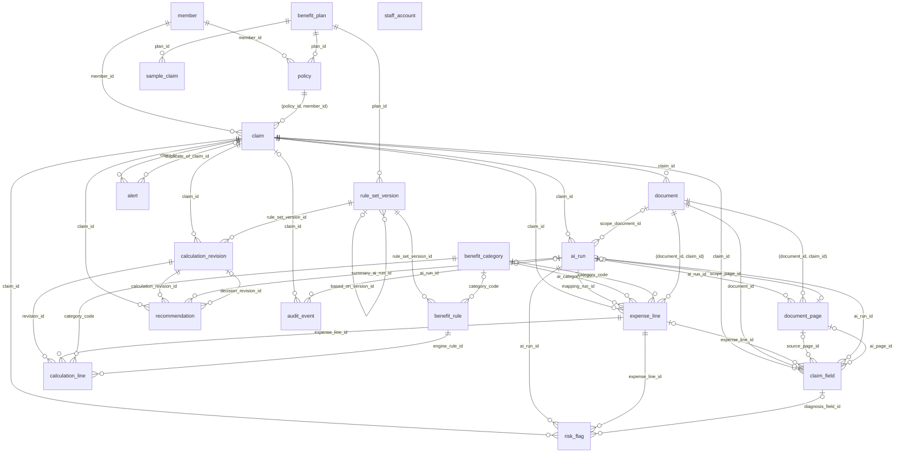
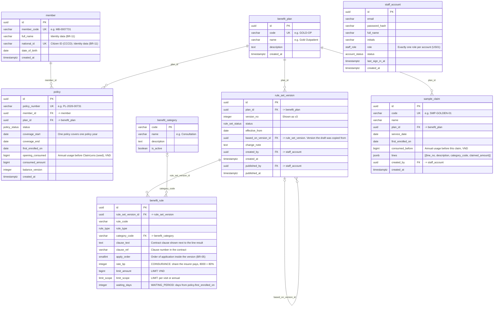
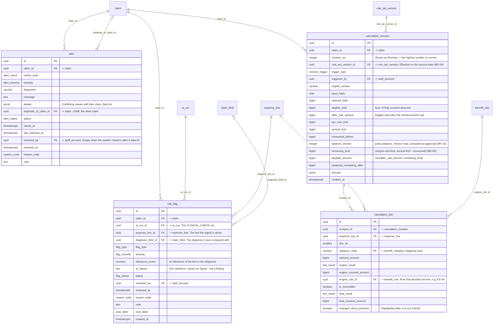
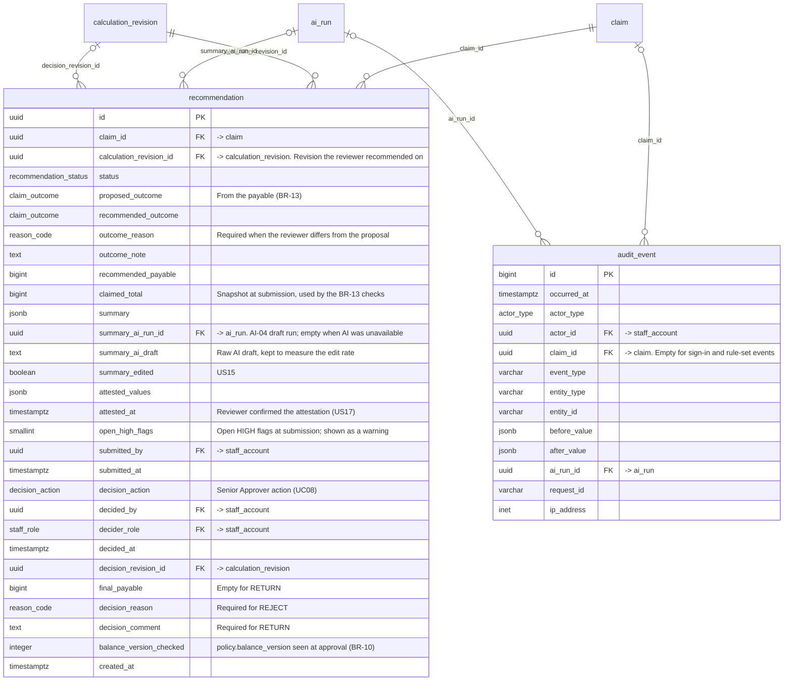

# Data Model

> Design status: TARGET MVP
>
> Database: PostgreSQL 14 or later. Source of truth: [claimlens.dbml](diagrams/claimlens.dbml) (20 tables). The Mermaid diagrams below are drawn from the same DBML; if the two ever differ, the DBML wins.

The schema is built so that the database itself, not only the application, can check the product rule **AI reads, the Rule Engine calculates, people decide**. The latest AI output is kept next to the value people use, rule results next to human overrides, and the most important business rules (BR-01 to BR-13 in [Use cases](03-use-cases.md#business-rules-referenced-by-use-cases)) are written as constraints. All 11 use cases are covered by the 20 tables; no use case had to be removed.

## 1. Design decisions

| # | Decision | What the schema does | Requirement |
|---|---|---|---|
| D1 | AI output sits beside the value in use, never over it | `document_page`, `claim_field` and `expense_line` each carry `ai_*` columns (suggestion, confidence, level, run) next to the value people work with. The AI value is not overwritten when a person edits. | Cross-cutting constraint in [08](08-invest-requirements.md#cross-cutting-acceptance-constraints): accepted values stored separately from raw AI output |
| D2 | No source, no accepted value | `claim_field` cannot reach an accepted status without `source_page_id` and `source_bbox` (`ck_claim_field_source_required`). | BR-02 |
| D3 | The status says who decided | `field_status` separates `AUTO_ACCEPTED` (threshold, AI marker kept) from `CONFIRMED`, `CORRECTED`, `ENTERED` and `NOT_PRESENT` (a person). `AUTO_ACCEPTED` is only allowed when the AI level is `HIGH`. The AI quality metrics are counts over these columns. | BR-03, US06, US21 |
| D4 | Versioned, immutable rule sets | `rule_set_version` plus one `benefit_rule` table for all rule kinds, each with `rule_code`, `clause_text` and `apply_order`. Categories are a stable taxonomy (`benefit_category`) so AI-02 and the dashboard do not depend on a version. | BR-04, BR-05, US19 |
| D5 | Every calculation is a numbered snapshot | `calculation_revision` stores the rule-set version, limits, the balance it read, the payable, an `input_hash` and the formula rows. `calculation_line` keeps the engine result next to the final result. | US11, US12, US13 |
| D6 | The override lives on the line | The active override is a set of `override_*` columns on `expense_line`, all-or-nothing, capped by the line amount and tied to an `OVERRIDE_*` reason. Every later revision applies it; the engine result stays visible in `calculation_line`. | BR-07, US16 |
| D7 | The balance lives on the policy | One policy is one insured person and one policy year, so `policy` holds `consumed_amount` and `balance_version`. Each revision records the version it read; approval locks the row, checks the version and adds the payable. | BR-10, US18 |
| D8 | Recommendation and decision share one row | A recommendation gets at most one decision, so the approver's columns sit on the same row. Maker–checker becomes `decided_by <> submitted_by`; the role is checked through `(decided_by, decider_role) → staff_account(id, role)`; BR-13 is checked against the `claimed_total` snapshot. | BR-01, BR-06, BR-13 |
| D9 | Reason codes are typed by use | `reason_code` is an enum whose prefix says where it may be used (`DISMISS_`, `KEEP_`, `OVERRIDE_`, `MISMATCH_`, `REJECT_`); each table checks the prefix. | BR-07, US16 |
| D10 | Synthetic test claims live apart | Rule-set test runs read `sample_claim`, never `claim`, so the Administrator needs no access to claim tables. Test results are computed on request and not stored. | BR-11, US20 |
| D11 | One insert-only audit trail | `audit_event` records every state change, correction, override, dismissal, decision and claim access with before and after values. It also keeps what the tables overwrite: earlier AI suggestions and earlier overrides. | BR-12, US22 |

## 2. Conventions

- **Keys.** Tables use `uuid` keys (safe in `/claims/:id` URLs, can be created by the AI service), except `benefit_category`, keyed by a readable code, and `audit_event`, keyed by a `bigint` identity for ordering.
- **Money** is `bigint` VND with no decimals. **Rates** are integer basis points: `rate_bp = 8000` means the insurer pays 80% and the insured co-pays 20%.
- **Confidence** is `numeric(4,3)` between 0 and 1. **Bounding boxes** are `jsonb` `{x, y, w, h}` normalised to the page (0 to 1), so they survive re-rendering at another size.
- **Time** is always `timestamptz`; dates the business uses (service date, effective-from) are `date`.
- **Fixed lists are enums**: statuses, `field_key` (the US05 field catalogue) and `reason_code`. Labels, threshold groups and the required flag of each field live in application code.
- **Settings without a UI** (BR-03 thresholds, BR-09 high-value threshold of 5,000,000 VND, file and page limits, required document types) live in application config. Each AI value stores the level it got, so changing a threshold does not rewrite history.
- **Constraint names** start with `ck_` (check), `ux_` (unique) or `ix_` (index), so an API error can be mapped to a message.

## 3. Overview

All 20 tables and how they connect; each line is labelled with the foreign-key column. Lines to `staff_account` (all `…_by`, `assignee_id` and `actor_id` columns) are left out to keep the picture readable.



## 4. ER diagrams by area

How to read them: `||` exactly one, `|o` zero or one, `o{` zero or more. Every column is listed with its key (`PK`, `FK`, `UK`); an `FK` comment names the table it points to. Each diagram draws the foreign keys held by its own tables; tables from other areas appear as plain boxes, and lines to `staff_account` are not drawn.

### 4.1 Access, policies and benefit rule sets



### 4.2 Intake, Document AI and evidence

```mermaid
erDiagram
    member ||--o{ claim : "member_id"
    claim ||--o{ document : "claim_id"
    ai_run |o--o{ document_page : "ai_run_id"
    claim ||--o{ ai_run : "claim_id"
    document |o--o{ ai_run : "scope_document_id"
    document_page |o--o{ ai_run : "scope_page_id"
    claim ||--o{ claim_field : "claim_id"
    document ||--o{ claim_field : "document_id"
    expense_line |o--o{ claim_field : "expense_line_id"
    document_page |o--o{ claim_field : "source_page_id"
    ai_run |o--o{ claim_field : "ai_run_id"
    document_page |o--o{ claim_field : "ai_page_id"
    claim ||--o{ expense_line : "claim_id"
    ai_run |o--o{ expense_line : "mapping_run_id"
    document ||--o{ expense_line : "(document_id, claim_id)"
    policy ||--o{ claim : "(policy_id, member_id)"
    document ||--o{ document_page : "(document_id, claim_id)"
    claim {
        uuid id PK
        varchar claim_number UK "CLM-YYYY-NNNNNN"
        uuid member_id FK "-> policy"
        uuid policy_id FK "-> policy"
        varchar provider_name "e.g. Phòng khám Đa khoa Hồng Ngọc"
        varchar provider_tax_code
        date service_date "Selects the rule-set version (BR-04)"
        bigint claimed_total "VND, entered at intake"
        intake_channel channel
        claim_status status
        timestamptz status_changed_at "Queue age"
        uuid registered_by FK "-> staff_account. Intake Officer; may see this claim (BR-11)"
        uuid assignee_id FK "-> staff_account. One reviewer per claim; an attribute, not a state (US23)"
        timestamptz assigned_at
        timestamptz submitted_at
        golden_scenario golden_scenario "Set only on golden-set claims (Definition of Done, US21)"
        integer row_version "Optimistic lock behind the Conflict UI state"
        timestamptz created_at
        timestamptz updated_at
    }
    document {
        uuid id PK
        uuid claim_id FK "-> claim"
        varchar original_filename
        file_format file_format
        bigint size_bytes
        char sha256
        varchar original_key "Object-storage key of the original file"
        varchar rendition_key "PDF rendition of a DOCX or XLSX file (US03)"
        smallint page_count
        document_status status
        varchar rejection_reason
        uuid uploaded_by FK "-> staff_account"
        timestamptz uploaded_at
        uuid removed_by FK "-> staff_account"
        timestamptz removed_at
    }
    document_page {
        uuid id PK
        uuid document_id FK "-> document"
        uuid claim_id FK "-> document"
        smallint page_no "Page inside the file"
        smallint claim_page_no "p1..p30 across the claim"
        varchar image_key "Rendered page image for the viewer and AI"
        integer width_px
        integer height_px
        page_type page_type "Type in use"
        value_source page_type_source
        uuid page_type_set_by FK "-> staff_account"
        page_quality quality
        page_ai_status ai_status "Document rail status"
        uuid ai_run_id FK "-> ai_run. Latest page check or re-read"
        page_type ai_page_type "AI suggestion; Unclassified in use when below 0.80"
        numeric ai_type_confidence
        confidence_level ai_type_level
        numeric ai_quality_score
    }
    ai_run {
        uuid id PK "The run ID shown on the timeline (US05)"
        uuid claim_id FK "-> claim"
        ai_task task
        uuid scope_document_id FK "-> document. PAGE_CHECK: the uploaded file"
        uuid scope_page_id FK "-> document_page. PAGE_REREAD: the only page read again"
        varchar model_name
        varchar model_version "Dashboard filter, e.g. v2.4"
        ai_run_status status
        varchar error_code
        uuid triggered_by FK "-> staff_account. Empty when the system started it as part of a task"
        timestamptz requested_at
        timestamptz started_at
        timestamptz finished_at
        varchar raw_output_key
    }
    claim_field {
        uuid id PK
        uuid claim_id FK "-> claim"
        uuid document_id FK "-> document. Evidence tab groups fields by document"
        field_key field_key
        smallint item_no "0 = document header; n = expense line or prescription item n"
        uuid expense_line_id FK "-> expense_line. Line fields only"
        field_status status
        text value_text "Value in use, as text"
        bigint value_amount "Money fields, VND"
        date value_date "Date fields"
        uuid source_page_id FK "-> document_page"
        jsonb source_bbox "{x, y, w, h}; drawn by the reviewer when AI gave none"
        uuid ai_run_id FK "-> ai_run. Latest extraction or re-read that filled the ai_* columns"
        text ai_value "Raw AI value; kept even below 0.70 but never shown (US05)"
        numeric ai_confidence "The Evidence tab sorts lowest first"
        confidence_level ai_level
        uuid ai_page_id FK "-> document_page"
        jsonb ai_bbox
        uuid resolved_by FK "-> staff_account"
        timestamptz resolved_at
        integer row_version
    }
    expense_line {
        uuid id PK
        uuid claim_id FK "-> document"
        uuid document_id FK "-> document. The invoice the line was read from"
        smallint line_no
        text description "As printed, e.g. Kem dưỡng phục hồi da Obagi"
        numeric quantity
        bigint unit_price
        bigint amount "Claimed line amount, VND; required before adjudication"
        line_origin origin
        uuid mapping_run_id FK "-> ai_run. AI-02 run that filled ai_category_code"
        varchar ai_category_code FK "-> benefit_category"
        numeric ai_confidence
        confidence_level ai_level "HIGH at 0.85 or more: auto-accepted"
        varchar category_code FK "-> benefit_category. Benefit category in use"
        mapping_status mapping_status
        uuid mapping_resolved_by FK "-> staff_account"
        timestamptz mapping_resolved_at
        line_result override_result "Active reviewer override (US16)"
        bigint override_amount
        reason_code override_reason
        text override_note
        uuid override_by FK "-> staff_account"
        timestamptz override_at
    }
```



### 4.3 Validation, risk and adjudication



### 4.4 Recommendation, decision and audit



## 5. Table catalogue

| Area | Table | Holds | Use cases |
|---|---|---|---|
| Access & policy | `staff_account` | Seeded staff, exactly one role each; `initials` replace the AI marker. | UC01 |
| | `member` | Insured person; name, citizen ID and birth date are identity data (BR-11). | UC02 |
| | `benefit_plan` | Product, e.g. `GOLD-OP` Gold Outpatient. | UC02, UC09 |
| | `policy` | A member's policy for one year: plan, status, coverage, enrolment date, annual usage and its version. | UC02, UC05, UC08 |
| Rule sets | `rule_set_version` | A versioned rule set of a plan; immutable once published. | UC09, SYS-01 |
| | `benefit_category` | Stable benefit taxonomy used by AI-02 and the dashboard. | UC05, UC09, UC10 |
| | `benefit_rule` | One rule with code, clause and order: eligibility, coverage, exclusion, waiting period, coinsurance, limit. | UC05, UC09 |
| | `sample_claim` | Synthetic claim with its lines, for test runs. | UC09 *Test draft* |
| Intake & evidence | `claim` | The case: member, policy, provider, service date, claimed total, channel, status, assignee. | UC02–UC08 |
| | `document` | An uploaded file, its PDF rendition and upload status. | UC02 |
| | `document_page` | One page: type in use and AI page type, quality, AI status. | UC02, UC03 |
| | `ai_run` | One AI call: task, model and version, status. A failed run switches on the manual fallback. | AI-01–AI-04, UC10 |
| | `claim_field` | Each field slot: value in use, source region, AI suggestion, who resolved it. | UC03, UC04, UC10 |
| | `expense_line` | Accepted line values, AI-02 suggestion and category in use, active override. | UC05, UC07 |
| Checks & adjudication | `alert` | Deterministic check results, including exact duplicates. | UC04 |
| | `risk_flag` | AI-03 clinical signal on one line, its evidence and the reviewer's disposition. | UC04, UC06, UC08 |
| | `calculation_revision` | Numbered, immutable result: rule-set version, limits, balance read, payable, formula. | UC05, UC08 |
| | `calculation_line` | Engine result and final result per line, with the deciding rule. | UC05 |
| Decision & audit | `recommendation` | The reviewer's proposal, summary with citations, attested AI values, and the approver's decision. | UC07, UC08 |
| | `audit_event` | Insert-only event log behind the Timeline. | UC11, BR-12 |

## 6. What the model keeps where

Some data that could have had its own table is folded into a column, a `jsonb` value or the audit trail. Each choice keeps what the use cases need and accepts one limit.

| Data | Kept in | What is given up |
|---|---|---|
| AI suggestion per page, field and line | `ai_*` columns of `document_page`, `claim_field`, `expense_line` (latest run); full response in object storage (`ai_run.raw_output_key`) | Older AI values after a page re-read are in `audit_event`, not queryable as rows. The dashboard counts the latest run. |
| Annual benefit usage | `policy.consumed_amount` and `balance_version`; each approval is a `recommendation` row with `final_payable` | No separate ledger; reversing an approval is out of MVP scope. |
| Approver decision | Columns on `recommendation` | None in the MVP: a recommendation has at most one decision. |
| Line override | `override_*` columns on `expense_line` | Only the active override is a row; earlier ones are in `audit_event`. |
| Payable formula | `calculation_revision.formula` (`jsonb`) | Formula rows cite rule codes, not foreign keys; the codes are unique inside the immutable version. |
| Summary sentences and citation chips | `recommendation.summary` (`jsonb`) | No foreign keys behind chips; they cite facts frozen once the claim is `PENDING_APPROVAL`. |
| Attested AI values | `recommendation.attested_values` (`jsonb`) | Snapshot, not foreign keys; that is what an attestation should be. |
| Alert evidence | `alert.details` (`jsonb`) with the `claim_field` ids | No foreign keys from evidence to fields. |
| Risk flag evidence | `risk_flag.expense_line_id` and `diagnosis_field_id` | One line per flag; every AI-03 flag type is about one line against the diagnosis. |
| Invoice header and provider | `claim_field` slots (`invoice_number`, `invoice_total`, …) and `claim.provider_name`, `provider_tax_code` | Duplicate lookup reads `claim_field` by `(field_key, value_text)` and the claim's provider, not a separate invoice table. |
| Field catalogue, reason codes, thresholds | Enums and application config | Adding a field or reason code is a migration (`alter type … add value`). |
| Rule-set test results | Computed on request; the run is an `audit_event` | Earlier test runs cannot be reopened. |
| Golden-set labels | `claim.golden_scenario`, `risk_flag.eval_label`; expected amounts in the test fixtures | Expected results are not in the database. |

## 7. Claim lifecycle in data

What must be true in the tables before a claim can enter each status. The move itself is guarded by a trigger on `claim.status`.

| Status | Data that must hold |
|---|---|
| `DRAFT` | A `claim` row with member, a policy of that member, provider, service date, claimed total and `registered_by`. |
| `PROCESSING` | At least one `document` in `READY`; `submitted_at` set; a `FIELD_EXTRACTION` run queued. |
| `NEEDS_VERIFICATION` | Extraction finished with a required `claim_field` in `NEEDS_VERIFICATION` or `NEEDS_ENTRY`, or the run `FAILED`. |
| `READY_FOR_REVIEW` | Every required field slot resolved (`AUTO_ACCEPTED`, `CONFIRMED`, `CORRECTED`, `ENTERED` or `NOT_PRESENT`) and no page left `UNCLASSIFIED`. |
| `IN_REVIEW` | `assignee_id` set (`ck_claim_assignee_required`). Returned = latest `recommendation` is `RETURNED`. |
| Adjudication may run | No `alert` that is `OPEN` and `BLOCKING`; every `expense_line` has an amount and a mapping that is not `PENDING` or `NEEDS_CONFIRMATION`; a `PUBLISHED` `rule_set_version` is effective on the service date. |
| `PENDING_APPROVAL` | A `SUBMITTED` `recommendation` on the latest revision, with `attested_at` and `attested_values`. |
| `APPROVED`, `PARTIALLY_APPROVED`, `REJECTED` | The `recommendation` is `DECIDED` by a `SENIOR_APPROVER` who is not the submitter, with an action that matches BR-13. An approval adds `final_payable` to `policy.consumed_amount` and raises `balance_version`. |
| Back to `IN_REVIEW` | The `recommendation` is `RETURNED` with a comment. |

## 8. Business rules in the schema

| Rule | Where it is enforced |
|---|---|
| BR-01 No outcome without a Senior Approver | Final statuses are reachable only through a decided `recommendation` (status trigger); `ck_decision_role` and the foreign key `(decided_by, decider_role) → staff_account(id, role)`. |
| BR-02 Every value has a source | `claim_field.source_page_id`, `source_bbox`, `ai_page_id`, `ai_bbox`; `ck_claim_field_source_required`. |
| BR-03 Confidence thresholds | `ai_level` on every AI value; `ck_claim_field_auto_from_ai`, `ck_expense_line_auto_from_ai`; `recommendation.attested_values`. |
| BR-04 Version on the service date | `rule_set_version.effective_from`; `calculation_revision.rule_set_version_id`; one published version per effective date (partial unique index). |
| BR-05 Line results and payable | `benefit_rule` kinds and `apply_order`; result checks on `calculation_line` and `expense_line` overrides; `ck_revision_payable_formula`. |
| BR-06 Maker–checker | `ck_decision_maker_checker` (`decided_by <> submitted_by` on the same row). |
| BR-07 Reasons and override caps | `ck_alert_dismiss_reason`, `ck_risk_flag_reason`, `ck_override_complete`, `ck_override_cap`, and the reason-prefix checks. |
| BR-08 Alert versus risk flag | Deterministic checks → `alert` (including `DUPLICATE_INVOICE`); AI signals → `risk_flag`, which no calculation table references. |
| BR-09 Approval queue priority | Sort by the latest revision's payable against the configured high-value threshold, open `HIGH` flags, then `submitted_at`. |
| BR-10 Balance consumed on approval, re-checked | `policy.balance_version`; `calculation_revision.balance_version`; `recommendation.balance_version_checked`; `ck_policy_consumed`. |
| BR-11 Who sees claim data | `claim.registered_by`, `claim.assignee_id` and the staff role drive row-level security; synthetic `sample_claim` for the Administrator. |
| BR-12 Immutable audit | `audit_event`, insert-only. |
| BR-13 Outcome by amount | `proposed_outcome` and `ck_recommendation_mismatch_reason`; `ck_decision_br13_approved`, `_partial`, `_rejected`. |

## 9. The golden case as rows

`CLM-2026-000184` uses the five invoice lines of the UI prototype ([stitch-prompts](stitch-prompts.md#dữ-liệu-mẫu-dùng-chung-golden-case)).

| Table | Rows |
|---|---|
| `policy` | `PL-2026-00731` on `GOLD-OP`; `opening_consumed` and `consumed_amount` 4,200,000; `balance_version` 1. |
| `rule_set_version`, `benefit_rule` | v3, effective 01/01/2026: `COV-01`, `COV-03`, `COV-04`, `COV-05`, `EX-04`, `COINS-80` (`rate_bp` 8000), `LIM-ANNUAL` (5,000,000), `LIM-VISIT` (2,000,000, assumed). |
| `document`, `document_page` | 4 files, 5 pages (invoice p1–p2, receipt, prescription, visit summary). |
| `claim_field` | Invoice `HN-0045821`, insured name, line fields, diagnosis `J02.9` (AI below 0.70, entered by the reviewer). |
| `expense_line` | Lines 300,000 · 250,000 · 150,000 · 300,000 · 400,000; line 4 mapped to `COSMETIC` at 0.81 and confirmed by the reviewer. |
| `calculation_revision` #2 | Eligible 1,100,000; after rate 880,000; remaining = min(2,000,000; 5,000,000 − 4,200,000) = 800,000; payable 800,000; projected after 0. Formula: 1,400,000 → `EX-04` −300,000 → `COINS-80` −220,000 → `LIM-ANNUAL` −80,000 → 800,000. |
| `calculation_line` | Lines 1, 2, 3, 5 `COVERED` by `COV-01`, `COV-03`, `COV-05`, `COV-04`; line 4 `EXCLUDED` by `EX-04`. |
| `alert` | `INVOICE_ARITHMETIC` resolved; `DATE_CONSISTENCY` warning (prescription 13/10/2026, invoice 12/10/2026). |
| `risk_flag` | `SERVICE_DIAGNOSIS`, `MEDIUM`, on line 5 against `J02.9`; kept for the approver. |
| `recommendation` | Proposed and recommended `PARTIALLY_APPROVED` (0 < 800,000 < 1,400,000); submitted by Trần Thu Hà, decided by Lê Minh Quân; the policy's usage becomes 5,000,000, version 2. |

## 10. Rules the DBML cannot express

These go in the migration next to the DDL exported from the DBML.

| Rule | Implementation |
|---|---|
| One open recommendation per claim | `create unique index ux_recommendation_open on recommendation (claim_id) where status in ('DRAFT', 'SUBMITTED');` |
| One published version per plan and date | `create unique index ux_rule_set_published_effective on rule_set_version (plan_id, effective_from) where status = 'PUBLISHED';` |
| Lifecycle moves only along the state diagram | Trigger on `claim.status`; final statuses only when the latest `recommendation` is `DECIDED` with the matching action. |
| Published rule sets are frozen | Trigger blocks updates to a `PUBLISHED` version and its `benefit_rule` rows, and requires `effective_from` later than the current published version. Publishing also checks that every active category has one `COVERAGE` or `EXCLUSION` rule. |
| Approval and usage stay in step | The decision and the `policy` update run in one transaction with the policy row locked; a trigger can assert `consumed_amount = opening_consumed + sum(final_payable)` of approved recommendations. |
| Audit is insert-only | `revoke update, delete on audit_event from claimlens_app;` optionally a hash chain over `id` order. |
| BR-11 visibility | Row-level security on `claim` and its child tables: Intake Officer where `registered_by = me`, Claims Reviewer where `assignee_id = me`, Senior Approver all, Administrator none. |
| Line values follow their fields | `expense_line` amounts and descriptions are written in the same transaction as the `claim_field` change that feeds them. |
| Vietnamese name search | `create extension pg_trgm; create extension unaccent;` and a GIN index on `unaccent(full_name)`. |

To get the DDL, paste the DBML into [dbdiagram.io](https://dbdiagram.io) and export PostgreSQL, or run:

```bash
npx @dbml/cli dbml2sql docs/diagrams/claimlens.dbml --postgres -o claimlens.sql
```

## 11. Open questions and assumptions

| # | Question | Assumption in this model |
|---|---|---|
| Q1 | The golden case differs between documents: [03](03-use-cases.md) UC05 and [08](08-invest-requirements.md) US12 use four lines (200,000 · 500,000 · 400,000 · 300,000), the UI prototype and stitch-prompts use five (300,000 · 250,000 · 150,000 · 300,000 · 400,000). Totals and payable are the same. | Seed data follows the UI. 03 and 08 should be aligned before the golden set is built. |
| Q2 | Intake channel values are not defined. | `COUNTER`, `POST`, `EMAIL`, `PARTNER`. |
| Q3 | Which documents are required (the `REQUIRED_DOCUMENTS` check)? | Config: invoice, receipt, visit summary; prescription when there are drug lines. |
| Q4 | The per-visit limit of `GOLD-OP` is not given. | 2,000,000 VND, so the annual limit caps the golden case. |
| Q5 | BR-10: when the balance changed during `PENDING_APPROVAL`, who re-runs adjudication, and what if the payable changes? | The system creates a `BALANCE_RECHECK` revision. Same payable: the approver decides on it (`decision_revision_id`). Different payable: the claim is returned to the reviewer. |
| Q6 | Waiting periods count from which date? | `policy.first_enrolled_on`, so renewals do not restart them. |
| Q7 | A category that is neither covered nor excluded in a version. | Not allowed: publishing requires every active category to be covered or excluded. |
| Q8 | Receipts may carry no seller tax code. | The duplicate check falls back to a normalised `provider_name`; the reviewer confirms. |
| Q9 | Who labels golden-set risk flags as true or false positives? | A Senior Approver during golden-set runs, stored in `risk_flag.eval_label`. |
| Q10 | How long are documents and audit events kept? | Not modelled; documents follow the storage lifecycle, `audit_event` can be partitioned by month. |

**Related:** [Use cases](03-use-cases.md) · [User stories](08-invest-requirements.md) · [Information architecture](04-information-architecture.md) · [DBML](diagrams/claimlens.dbml)
