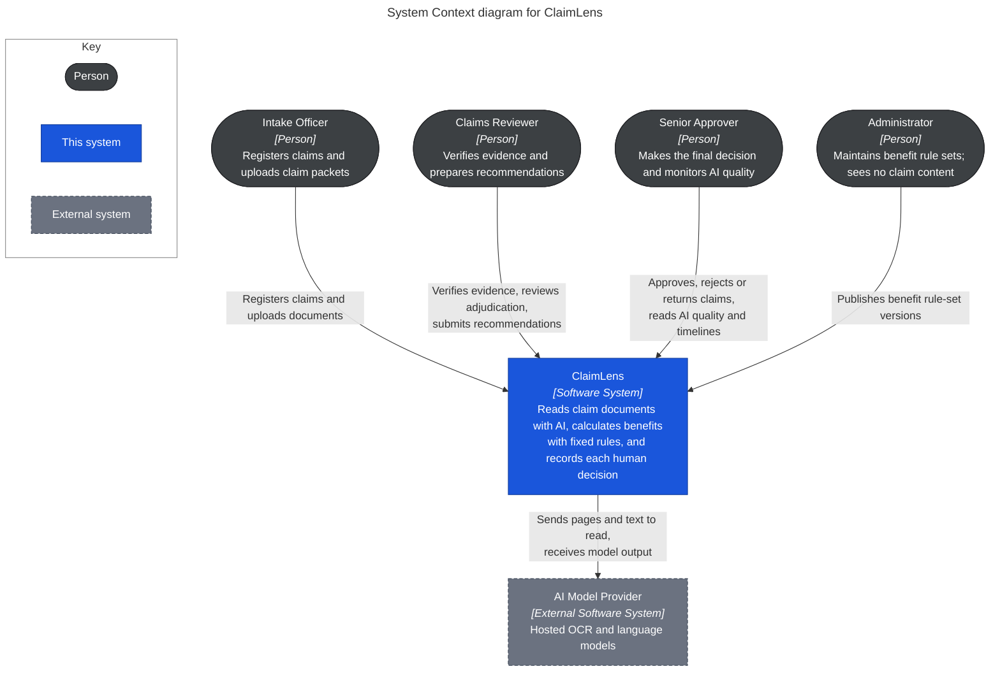

# C1: System Context

> Design status: TARGET MVP
>
> Purpose: show who uses ClaimLens and which outside system it depends on.

## System boundary

ClaimLens is responsible for sign-in and role routing, claim intake, AI-assisted reading of documents, validation, benefit calculation, risk flags, the two-person decision, rule-set versions, AI quality metrics and the audit trail.

These are deliberately not on the diagram, because the MVP has no connection to them:

| Left out | Why |
|---|---|
| Hospital, insurer and government systems | Out of scope for the MVP in [product research](../../../01_Product_Research.xmind). Members and policies are seeded, with no external lookup (US02). |
| Policyholder | Benefits indirectly but has no portal. Contacting them happens outside the system. |
| Payment | ClaimLens records a decision and the benefit balance. It does not pay anyone. |

## Users

| Person | Primary use | Limit |
|---|---|---|
| Intake Officer | UC01, UC02 | Sees medical data only on claims they registered (BR-11) |
| Claims Reviewer | UC01, UC03 to UC07, UC11 for own claims | Cannot decide a claim |
| Senior Approver | UC01, UC08, UC10, UC11 | Cannot decide a recommendation they submitted (BR-06) |
| Administrator | UC01, UC09 | Sees no claim content; test runs use synthetic claims only (BR-11) |

The full permissions are in [Roles and permissions](../../../README.md#15-roles-and-permissions).

## External system

| System | Used for | Constraint |
|---|---|---|
| AI Model Provider | OCR and language tasks behind AI-01 to AI-04 | Only synthetic or de-identified claim data is sent in the MVP. Sending real medical or identity data needs a separate decision first. ClaimLens keeps working by hand when the provider is down. |

## Where the AI service sits

The [use case diagrams](../../03-use-cases.md#use-case-diagram) show the AI Document Intelligence Service as a secondary actor outside the system boundary. That view is about who takes part in a use case. Here the question is who builds and runs it: the team does, so it is a container inside ClaimLens ([C2](02-container.md)). The only outside system is the model provider it calls.

**Next:** zoom into ClaimLens → [C2: Container](02-container.md) · **Up:** [C4 overview](README.md)

**Sources of truth:** [Use cases](../../03-use-cases.md), [INVEST requirements](../../08-invest-requirements.md).
