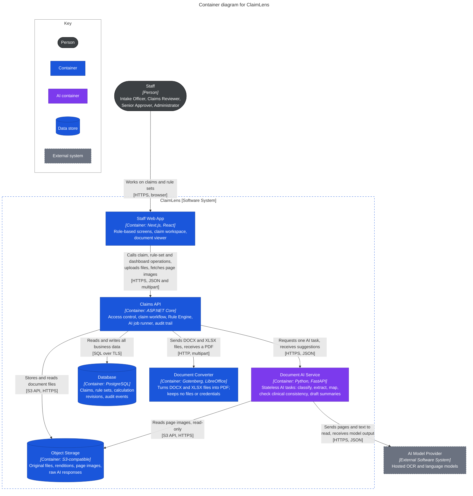

# C2: Container

> Design status: TARGET MVP
>
> Purpose: zoom into ClaimLens and show the applications and data stores that must run for it to work.

The roles are one box here because they all reach ClaimLens the same way. What each role may do is enforced inside the Claims API and shown in [C1](01-system-context.md#users).

A reverse proxy serves the Staff Web App and the Claims API from one origin. It holds no behaviour, so it is not drawn; it is in [Code structure](../../10-code-structure.md#12-running-it).

## Responsibilities

| Container | Owns | Does not own |
|---|---|---|
| Staff Web App | Screens, navigation by role, UI states, the AI markers and fallback banner | Business rules, permissions (hiding a button is only UX), direct access to any data store |
| Claims API | Access control, claim lifecycle, confidence thresholds, validation, Rule Engine, decisions, audit trail, page rendering, AI job queue | Reading documents, converting files, calling the AI Model Provider |
| Document AI Service | Turning pages and text into suggestions with confidence and source | Thresholds, coverage, money, any database or stored state |
| Database | All 21 tables and the constraints in the [data model](../../06-data-model.md) | File contents (it stores object keys only) |
| Object Storage | Files, addressed by generated keys | Access rules (only the two services hold credentials) |
| Document Converter | Turning a DOCX or XLSX file into a PDF, one request at a time | Anything stored. It parses uploaded files, so it keeps none and holds no credentials |

The Rule Engine is not a container. It runs inside the Claims API, so there is no network call between a calculation and the data it uses ([C3](03-component-claims-api.md)).

## Architecture rules

1. **The browser talks only to the Claims API.** It never reaches the database, Object Storage or Document AI Service. Page images pass through the API, so every read of claim data is checked and audited (BR-11, BR-12).
2. **The API enforces permissions.** Role checks, claim scope and maker–checker all run there, whatever the UI shows (BR-06, BR-11).
3. **Only the Claims API writes to the database.** The Document AI Service has no database credentials and only returns suggestions.
4. **The Claims API applies the thresholds.** The Document AI Service reports raw confidence; turning it into High, Check or Missing happens in one place (BR-03).
5. **Calculation never depends on AI being up.** The Rule Engine does not call the Document AI Service or the AI Model Provider. It uses only values already in the database (BR-05).
6. **Upload and viewing work without AI.** Page rendering lives in the Claims API and file conversion in the Document Converter, because US04 requires submission to continue when the AI service fails.
7. **Only the Document AI Service calls the AI Model Provider,** and in the MVP it only ever receives synthetic or de-identified claim data.
8. **Files go to Object Storage, facts go to PostgreSQL.** The database holds `original_key`, `rendition_key`, `image_key` and `raw_output_key`, never the bytes.

## How a claim packet moves through the containers

1. The Intake Officer uploads a file. The Claims API checks type and size, stores the original, has the Document Converter turn a DOCX or XLSX file into a PDF rendition, renders page images and queues a `PAGE_CHECK` run in `ai_run`.
2. The job runner in the Claims API picks up the run and calls the Document AI Service with the page references. That service reads the images from Object Storage and calls the AI Model Provider.
3. The Claims API stores the full response in Object Storage, applies the BR-03 thresholds and writes the suggestions beside the values in use. The Staff Web App polls for page status, so no push connection is needed. That one endpoint carries no claim content, so polling is not audited.
4. On submit, the same path runs `FIELD_EXTRACTION`, and the claim moves to `NeedsVerification` or `ReadyForReview`.
5. Validation and the Rule Engine then run inside the Claims API on accepted values. AI only adds suggestions along the way: `BENEFIT_MAPPING` before adjudication, and `CLINICAL_CHECK`, which can raise flags but never changes an amount.

The step-by-step sequence diagrams belong to the separate sequence diagram task.

## When a container is down

| Down | What happens | Source |
|---|---|---|
| Document AI Service or AI Model Provider | The run is marked `FAILED`. Pages stay Unclassified, fields are left empty and the claim goes to `NeedsVerification`, lines need a manual category, the claim shows "Clinical check not run", and the summary box is an empty template. Work continues by hand. | US04, US05, US09, US10, US15 |
| Object Storage | Uploads and the document viewer fail with an error. Other screens keep working. | |
| Document Converter | DOCX and XLSX files are rejected with the reason. JPG, PNG and PDF files and every other screen keep working. | US03 |
| Database | The Claims API cannot serve requests. There is no degraded mode. | |

**Previous:** [C1: System Context](01-system-context.md) · **Next:** [C3: Claims API](03-component-claims-api.md), [C3: Document AI Service](03-component-document-ai.md) · **Up:** [C4 overview](README.md)

**Sources of truth:** [INVEST requirements](../../08-invest-requirements.md), [Data model](../../06-data-model.md), [claimlens.dbml](../../diagrams/claimlens.dbml), [API contract](../../07-api-contract.md).
