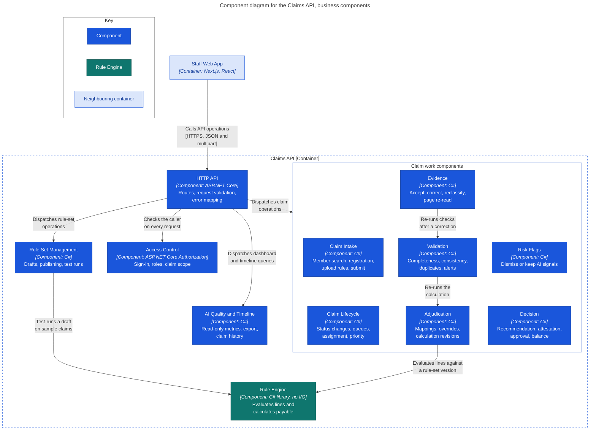
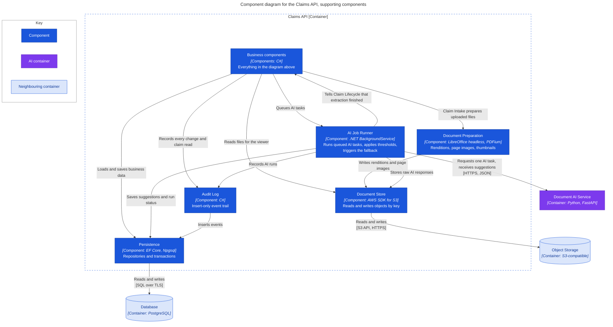

# C3: Component, Claims API

> Design status: TARGET MVP
>
> Purpose: zoom into the Claims API and show where each business rule lives, especially the Rule Engine and the boundary with AI.

## Business components

"Claim work components" is only a grouping: an arrow to it applies to each component inside.

## Supporting components

These components do the work that every business component shares, and hold all the connections that leave the Claims API.

## Component catalogue

(Should) marks a story that follows in the next increment. Those stories are listed so that the structure does not change when they arrive.

| Component | Owns | Does not own | Stories and rules |
|---|---|---|---|
| HTTP API | Transport, request validation, mapping `ck_` and `ux_` constraint names to error messages | SQL and business decisions | All |
| Access Control | Sign-in, one role per account, claim scope for every read | UI visibility | US01, BR-11 |
| Claim Intake | Member search, claim registration, file type, size and page limits, submit | Reading documents | US02, US03 |
| Claim Lifecycle | Allowed status changes, review and approval queues, self-assignment, priority | What a reviewer verifies | US23, BR-09 |
| Evidence | Accepting, correcting and entering field values, reclassifying pages, requesting a page re-read | Applying thresholds to AI output | US06, BR-02 |
| Validation | Required documents, identity and date consistency, invoice arithmetic, duplicate detection, alerts | Clinical judgement, which is AI-03 | US07, US08, BR-07, BR-08 |
| Adjudication | Confirming mappings, line overrides, numbered calculation revisions and re-runs | Evaluating rules, which is the Rule Engine | US10 to US13, US16, BR-07 |
| Rule Engine | Eligibility, waiting periods, exclusions, reimbursement rate, limits, payable amount and formula | Reading documents, guessing missing values, any database, clock or network access | US11, US12, SYS-01, BR-04, BR-05 |
| Risk Flags | Dismissing or keeping AI signals, with a reason | Producing the signal, or changing any amount | US09 (Should), US14 (Should), BR-07, BR-08 |
| Decision | Recommendation and attestation, maker–checker, outcome against amount, balance re-check and update | Calculating the payable | US15 (Should), US17, US18, BR-01, BR-06, BR-10, BR-13 |
| Rule Set Management | Draft versions, publishing with an effective date, test runs on `sample_claim` | Reading real claims | US19, US20 (Should), BR-04, BR-11 |
| AI Quality and Timeline | AI quality metrics, XLSX export, claim timeline | Changing any data | US21 (Should), US22, BR-11 |
| Document Preparation | DOCX and XLSX renditions, page split, page images, thumbnails, conversion failures | Anything AI | US03 |
| AI Job Runner | Picking up `QUEUED` runs, calling the Document AI Service, storing raw output, applying BR-03 levels, marking `FAILED` on an error or timeout | The AI work itself, or deciding what a person accepts | US04, US05, US09, US10, US15, BR-03 |
| Audit Log | Insert-only events with actor, time, before and after values | Primary business data | US22, BR-12 |
| Persistence | Repositories, transactions, row locks for the balance check | HTTP and permissions | All |
| Document Store | Generated keys, reading and writing objects | Business metadata and permissions | US03 |

## Rules that shape the structure

1. **The Rule Engine is a pure function.** It takes accepted values, one rule-set version and a balance, and returns line results and a formula. It has no I/O, so the same inputs always give the same answer (US11). Adjudication loads the inputs and saves the revision, including `input_hash`.
2. **Dependencies point towards the Rule Engine, never out of it.** Adjudication and Rule Set Management call it. Test runs reuse the same code on `sample_claim`, so a draft rule set is tested by the real engine (US20).
3. **No path leads from AI to money without a person.** The AI Job Runner writes suggestions only, in the `ai_*` columns or as an `AUTO_ACCEPTED` status. The Rule Engine reads only accepted values, and the reviewer attests to auto-accepted ones at submission (US17).
4. **Thresholds live in the AI Job Runner.** It reads them from application config and stores the resulting level on each value, so changing a threshold does not rewrite history (BR-03).
5. **Status changes go through Claim Lifecycle.** A database trigger checks the same lifecycle as a second line of defence.
6. **The database repeats the critical rules.** Maker–checker, a source for every accepted value and the override cap are also constraints (D2, D6, D8 in the [data model](../../06-data-model.md#1-design-decisions)). A code bug fails loudly instead of storing a wrong decision.
7. **Every read of claim data is audited,** not only every change (BR-12). Claim work components call Audit Log after Access Control has allowed the read.

## How AI jobs run

The `ai_run` table is the queue. A component inserts a row with status `QUEUED`, including the model name and version from application config, which is why the model version is known before the call. The AI Job Runner claims rows with `FOR UPDATE SKIP LOCKED`, so several API instances can share the queue without taking the same job.

A call that fails or times out marks the run `FAILED` with an `error_code`, and that status is what triggers the manual fallback. A run left in `RUNNING` after a crash is treated the same way once its timeout passes.

**Previous:** [C2: Container](02-container.md) · **See also:** [C3: Document AI Service](03-component-document-ai.md) · **Up:** [C4 overview](README.md)

**Sources of truth:** [Use cases](../../03-use-cases.md), [INVEST requirements](../../08-invest-requirements.md), [Information architecture](../../04-information-architecture.md#screen-to-api-mapping), [claimlens.dbml](../../diagrams/claimlens.dbml).
