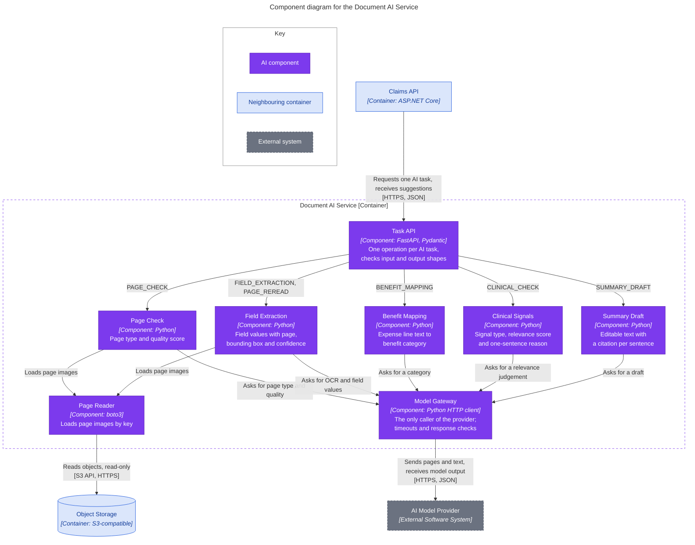

# C3: Component, Document AI Service

> Design status: TARGET MVP
>
> Purpose: zoom into the Document AI Service and show how the six AI tasks are kept to suggestions only.

## Component catalogue

(Should) marks a story that follows in the next increment.

| Component | AI use case and `ai_task` | Returns | Does not do | Stories |
|---|---|---|---|---|
| Task API | All | The task's result plus the model name and version used | Business rules | All |
| Page Check | AI-01, `PAGE_CHECK` | Page type, type confidence, quality score | Mark a page Unclassified or Low quality; the Claims API does, from the score | US04 |
| Field Extraction | AI-01, `FIELD_EXTRACTION`, `PAGE_REREAD` | For each field in the catalogue: value, page, bounding box (0 to 1), confidence | Guess a value it cannot find; it returns none | US05, US06 |
| Benefit Mapping | AI-02, `BENEFIT_MAPPING` | Benefit category and confidence per line, from the list it was given | Decide coverage or amounts | US10 |
| Clinical Signals | AI-03, `CLINICAL_CHECK` | Signal type, relevance score and reason per line | Raise a flag, set its severity or call anything fraud; the Claims API creates the flag and sets the severity from the score | US09 (Should) |
| Summary Draft | AI-04, `SUMMARY_DRAFT` | Sentences with citations to the items it was given | Use facts beyond those items, or submit anything | US15 (Should) |
| Page Reader | AI-01 tasks | Page images | Write to storage | US04, US05 |
| Model Gateway | All | Checked model output | Choose the model; the request names it | All |

## Rules that shape the structure

1. **The service is stateless.** It has no database, writes no files and remembers nothing between requests. The Claims API saves the full response as `raw_output_key`, so a run can be examined later without the service keeping anything.
2. **It reports, it does not decide.** Every result is a raw score or a suggestion. All thresholds (BR-03, quality and clinical) are applied by the [AI Job Runner](03-component-claims-api.md#how-ai-jobs-run).
3. **Input is limited to what the task needs.** Only Page Check and Field Extraction can read images. Benefit Mapping gets line text and the category list. Summary Draft gets only accepted facts, rule codes, overrides and kept flags, which is what makes its citations checkable (US15).
4. **Every value has a source.** A field without a page and bounding box cannot be accepted (BR-02), so Field Extraction returns the source with each value.
5. **Bad model output is a failed call.** Model Gateway checks each response against the expected shape. Failures reach the Claims API as an error, and the claim follows the normal [fallback](02-container.md#when-a-container-is-down). A single page that cannot be read is reported in the response, and only that page falls back.
6. **One way out to the provider.** Keeping the provider behind Model Gateway limits a change of provider to one component, and gives one place to control what data leaves ClaimLens.

**Previous:** [C2: Container](02-container.md) · **See also:** [C3: Claims API](03-component-claims-api.md) · **Up:** [C4 overview](README.md)

**Sources of truth:** [AI placement matrix](../../03-use-cases.md#ai-placement-matrix), [INVEST requirements](../../08-invest-requirements.md), [claimlens.dbml](../../diagrams/claimlens.dbml), [document-ai.yaml](../../api/document-ai.yaml).
