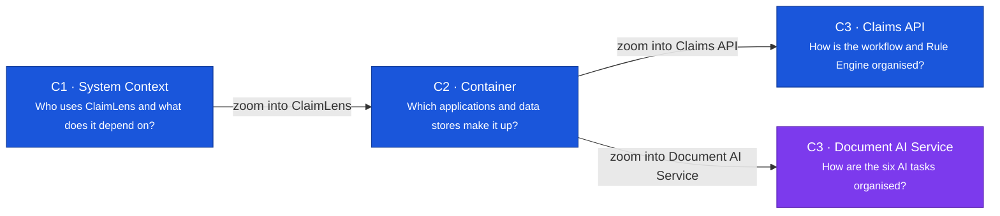

# C4 Model: ClaimLens

> Design status: TARGET MVP
>
> Audience: developers, reviewers and maintainers. Nothing here is built yet; these documents describe the system the MVP will implement.

The documents go from the outside in. Each level zooms into one box of the level above, and every box states its name, type, technology (from the Container level down) and responsibility.

| Level | Document | Scope |
|---|---|---|
| C1 | [System Context](01-system-context.md) | The four staff roles, ClaimLens and the AI Model Provider |
| C2 | [Container](02-container.md) | Staff Web App, Claims API, Document AI Service, PostgreSQL, Object Storage |
| C3 | [Component: Claims API](03-component-claims-api.md) | Workflow components, Rule Engine, AI Job Runner, audit |
| C3 | [Component: Document AI Service](03-component-document-ai.md) | The six AI tasks and the Model Gateway |

There is no C3 for the Staff Web App, because its structure is already covered by the [Information architecture](../../04-information-architecture.md). There is no C4 Code level: the C4 model treats it as optional, and the class diagrams are a separate item in the project plan.

## How to read the diagrams

Every diagram has a title and its own key. Colours are the same at every level, and each box also states its type in words, so a diagram still reads in black and white.

| Colour | Meaning |
|---|---|
| Dark grey, rounded | A person |
| Blue | Part of ClaimLens, not AI |
| Violet | AI. Same meaning as Insight Violet in the [design system](../../DESIGN.md) |
| Teal | The deterministic Rule Engine |
| Pale blue | A neighbouring container, shown for context on a C3 diagram |
| Grey, dashed border | A system outside ClaimLens |

Each arrow points from the caller to what it calls and says why. Arrows between containers also name the protocol.

## Decisions behind these documents

| Decision | Choice | Why |
|---|---|---|
| Backend | ASP.NET Core (C#) | Research left this open between .NET and Spring Boot. Either fits this design; a change only renames technologies in C2 and C3. |
| AI service | Python, FastAPI | Research asked for a Python service for OCR and document understanding. FastAPI is the assumed framework. |
| OCR and language models | Hosted by an external provider | Keeps the MVP free of GPU hosting. Allowed because the MVP uses only synthetic or de-identified claim data ([08](../../08-invest-requirements.md#cross-cutting-acceptance-constraints)). |
| Background jobs | A job runner inside the Claims API, reading `ai_run` | The schema already has a queue state (`QUEUED`), so the MVP needs no message broker. |
| Who writes the database | Only the Claims API | The Document AI Service returns suggestions and has no database access, so AI cannot accept its own output. |
| Keeping a user signed in | Access token and rotating refresh token | The access token lives 15 minutes in the page's memory; the refresh token sits in an HttpOnly cookie. See the [API contract](../../07-api-contract.md#sign-in-and-tokens). |

## Still open

- Which AI Model Provider to use, and the model versions for each task.
- Hosting and the Object Storage product. The design only needs the S3 API, and the Staff Web App and Claims API on the same site, because the refresh token cookie is `SameSite=Strict`.

## Terms

| Term | Meaning |
|---|---|
| BR-xx | A business rule in [Use cases](../../03-use-cases.md#business-rules-referenced-by-use-cases) |
| UC, US, AI-xx | Use case, user story and AI use case in the [requirements](../../08-invest-requirements.md) |
| OCR | Optical character recognition: reading text from an image |
| LLM | Large language model |
| RBAC | Role-based access control |
| Rendition | The PDF made from an uploaded DOCX or XLSX file, so its pages work like any other page |

**Related:** [Use cases](../../03-use-cases.md) · [Data model](../../06-data-model.md) · [Information architecture](../../04-information-architecture.md) · [API contract](../../07-api-contract.md)
