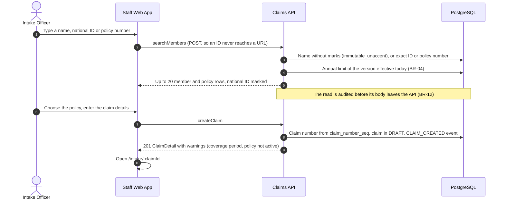

# Sequence: intake (Slice 1, US02 and US03)

> Built in Slice 1. Names are the `operationId`s of [claims-api.yaml](../api/claims-api.yaml) and the components of the [Claims API C3 view](../architecture/c4/03-component-claims-api.md).

The Intake Officer registers a claim, uploads its packet and submits it. Every call goes through the policy middleware first (role, scope, status), and every write records its audit event in the same transaction. The page check and field extraction are only queued here; the AI Job Runner of Slice 2 runs them.

## Register the claim (SCR-11, SCR-12)



## Upload and prepare the documents (SCR-13)

```mermaid
sequenceDiagram
    autonumber
    actor Officer as Intake Officer
    participant Web as Staff Web App
    participant API as Claims API
    participant Store as Object Storage
    participant DB as PostgreSQL
    participant Worker as Document Preparation
    participant Conv as Document Converter

    Officer->>Web: Drop JPG, PNG, PDF, DOCX or XLSX files
    Web->>Web: Refuse above 20 MB or an unknown extension, without sending
    Web->>API: uploadDocument, one file per request, with progress
    API->>API: Type from the first bytes, size at most 20 MB (415, 413)
    API->>Store: originals/{claimId}/{documentId}.{ext}
    API->>DB: Lock the claim, still DRAFT? document in CONVERTING, DOCUMENT_UPLOADED event
    API-->>Web: 201 Document (CONVERTING)
    API-)Worker: Wake up

    loop While a document is CONVERTING
        Worker->>DB: Oldest CONVERTING document not waiting out a failure, FOR UPDATE SKIP LOCKED
        Worker->>Store: Read the original
        alt DOCX or XLSX
            Worker->>Conv: LibreOffice route, file named from its detected type
            Conv-->>Worker: PDF rendition
        end
        Worker->>Worker: Draw each page as PNG (PDFium, or SkiaSharp turned upright by EXIF) and a thumbnail
        Worker->>DB: Lock the claim, number pages across it, at most 30
        Worker->>Store: renditions/, pages/, thumbnails/
        Worker->>DB: Pages, READY, one PAGE_CHECK run QUEUED, DOCUMENT_READY event (actor SYSTEM)
    end

    Note over Worker,Conv: A file that cannot be read or converted is REJECTED with a reason.<br/>When the converter or storage fails, the file waits (doubling) and the others go ahead;<br/>after MaxAttempts it is REJECTED so the officer can upload it again.

    loop Every 3 seconds while a file converts or a page check is waiting
        Web->>API: getClaimStatus (not audited, no file names)
        API-->>Web: Documents, pages and AI run states
    end
    Web->>API: listDocuments, then getPage?variant=thumbnail per page
    API->>Store: thumbnails/...
    API-->>Web: PNG with Cache-Control: private, no-store, shown from a blob URL
```

## Remove a file and submit

```mermaid
sequenceDiagram
    autonumber
    actor Officer as Intake Officer
    participant Web as Staff Web App
    participant API as Claims API
    participant DB as PostgreSQL
    participant Store as Object Storage

    Officer->>Web: Remove a file
    Web->>API: deleteDocument
    API->>DB: Document row NOWAIT (409 UPLOAD_IN_PROGRESS while the worker holds it)
    API->>DB: Delete its pages, renumber the rest p1 to pN, REMOVED, DOCUMENT_REMOVED event
    API->>Store: Delete its page images, after the commit
    API-->>Web: 204

    Officer->>Web: Submit
    Web->>API: submitClaim
    API->>DB: Lock the claim. A file uploading or converting? 409 UPLOAD_IN_PROGRESS. None READY? 409 NO_READY_DOCUMENT
    API->>DB: ClaimStatusMachine DRAFT to PROCESSING, FIELD_EXTRACTION run QUEUED, CLAIM_STATUS_CHANGED event
    API-->>Web: 202 status snapshot
    Web->>Web: Read-only view; the claim is listed under My submissions
```
