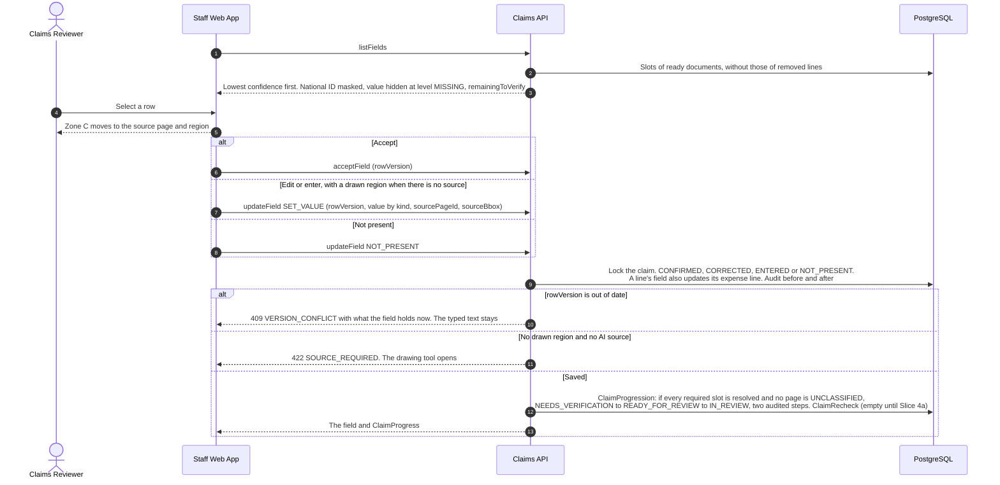
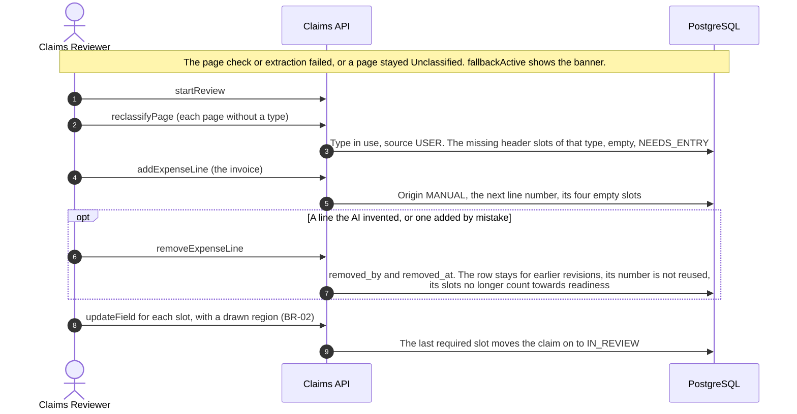

# Sequence: review queue and Evidence (Slice 3, US23 and US06)

> Built in Slice 3. Names are the `operationId`s of [claims-api.yaml](../api/claims-api.yaml) and the components of the [Claims API C3 view](../architecture/c4/03-component-claims-api.md).

Slice 2 leaves a claim in `NEEDS_VERIFICATION` or `READY_FOR_REVIEW` with nobody on it ([seq-02-ai-reading](seq-02-ai-reading.md)). Here a reviewer takes it and checks each field beside its source. The AI reads; a person decides what it read.

## Taking a claim (US23)

```mermaid
sequenceDiagram
    autonumber
    actor Reviewer as Claims Reviewer
    actor Other as Another reviewer
    participant Web as Staff Web App
    participant API as Claims API
    participant DB as PostgreSQL

    Reviewer->>Web: Open the review queue
    Web->>API: listClaims (view AVAILABLE)
    API->>DB: Unassigned, NEEDS_VERIFICATION or READY_FOR_REVIEW<br/>High value first, then the longest wait (BR-09). The member table is not read (BR-11)
    API-->>Web: Rows without a member name, counts for the four tabs
    Reviewer->>Web: Start review, or Open next claim (pageSize=1)
    Web->>API: startReview
    API->>DB: Lock the claim row. Set the assignee, READY_FOR_REVIEW moves to IN_REVIEW,<br/>NEEDS_VERIFICATION stays, audit REVIEW_STARTED
    API-->>Web: The claim, with allowedActions and blockers
    Other->>API: startReview on the same claim
    API-->>Other: 409 CLAIM_ALREADY_ASSIGNED. The list refreshes; Open next claim tries the next one
    opt Top bar lookup
        Other->>API: getClaimByNumber
        API-->>Other: 404, the same for a claim out of scope as for no claim
    end
```

## Verifying a field (US06)



## Reading one page again (US06)

```mermaid
sequenceDiagram
    autonumber
    actor Reviewer as Claims Reviewer
    participant Web as Staff Web App
    participant API as Claims API
    participant Runner as AI Job Runner
    participant AI as Document AI Service
    participant DB as PostgreSQL

    Reviewer->>Web: Re-run AI on this page
    Web->>API: rerunExtraction
    API->>DB: Queue PAGE_REREAD for the page, or answer with the run already waiting
    API-->>Web: 202 with the run
    loop Every 3 seconds while a re-read is queued or running, whichever page is on screen
        Web->>API: getClaimStatus
    end
    Runner->>AI: runPageReread (the page, the catalogue of its type)
    alt Answered
        AI-->>Runner: Value, confidence and region per field
        Runner->>DB: Lock the claim. The ai_* columns always update.<br/>A slot a person resolved keeps its value; the others take the new reading by the thresholds.<br/>A slot read on another page changes only for a more confident reading.<br/>A new invoice item adds a line; a removed line stays removed. Audit FIELD_AI_REREAD
    else Fails after the retries
        Runner->>DB: Only this page is FAILED, its empty header slots are there to enter, the rest stays
    end
    Web->>API: listFields, listDocuments and getClaim again
    Web-->>Reviewer: AI read p3 again, or AI could not read p3
    Note over DB: The status never goes back: an IN_REVIEW claim may hold an unresolved field after this,<br/>an added line or a new page type. It is counted, and submitRecommendation must refuse it (Slice 5).
```

## When the AI gave nothing


